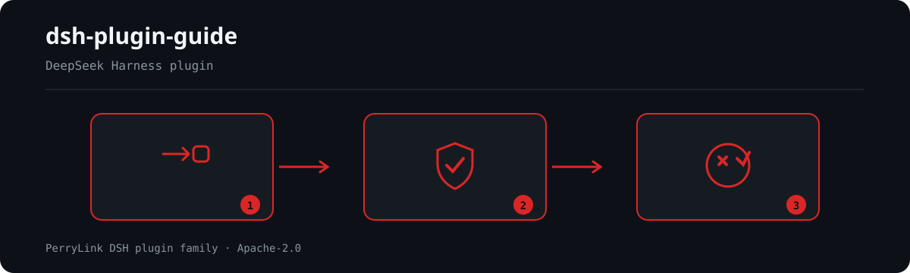

<div align="center">

# 🐳 dsh-plugin-guide

**Tudo o que você precisa para construir plugins do [DeepSeek Harness](https://github.com/deepseek-ai/deepseek-harness).**

*Arquivo de documentação oficial · primer de Cordis · deep-dives da comunidade · armadilhas testadas em batalha · agent skill · toolchain CLI*


```sh
dsh plugin --profile web add dsh-plugin-guide
```
[](LICENSE)
[](https://gitee.com/perrylink/dsh-plugin-guide)
[](https://github.com/topics/dsh-plugin)
[](https://github.com/PerryLink/dsh-plugin-doctor#verified-徽章)
[](https://dsh.market/)
[](#)
[](https://github.com/PerryLink/dsh-plugin-guide/actions)
[](https://github.com/PerryLink/dsh-plugin-guide/releases)
[](https://www.npmjs.com/package/dsh-plugin-guide)
[](https://www.npmjs.com/package/dsh-plugin-guide)
[](https://dshfind.com/pt/plugins/PerryLink/dsh-plugin-guide?ref=badge)

[English](README.md) · [简体中文](README-zh.md) · [Español](README-es.md) · [Português](README-pt.md) · [हिन्दी](README-hi.md)

```sh
dsh plugin --profile <name> add dsh-plugin-guide
```


</div>

---

**📖 Prefere ler como site?** [perrylink.github.io/dsh-plugin-guide](https://perrylink.github.io/dsh-plugin-guide/) — cada capítulo em sua própria página, além de um [llms.txt](https://perrylink.github.io/dsh-plugin-guide/llms.txt) legível por máquina para assistentes.

## Install & uninstall

- **canal git** (último `main`): `dsh plugin --profile web add github:PerryLink/dsh-plugin-guide#<sha>` — fixe um commit para reprodutibilidade; o ponto de entrada é JS ESM puro, sem etapa de build.
- **canal npm** (versões publicadas): `dsh plugin --profile web add dsh-plugin-guide`.
- **canal tarball**: `pnpm pack` neste repo, depois `dsh plugin --profile web add ./dsh-plugin-guide-<version>.tgz`.
- **desinstalar**: `dsh plugin --profile web remove dsh-plugin-guide`.

## Why not just read the official docs?

Porque ela é escrita para quem já sabe qual página abrir, e o DSH publica **uma versão preliminar a cada 1,7–2,8 dias** com mudanças que quebram compatibilidade. Este plugin cobre as três lacunas que mais custam tempo:

| Lacuna | O que este plugin acrescenta |
|---|---|
| **"Contra qual versão estou desenvolvendo?"** | Uma [matriz de versões](guide/version-matrix.md): os quatro valores que se chamam "latest", as tags `latest` congeladas dos subpacotes, as falhas de compatibilidade e como escolher um intervalo em `peerDependencies`. **Não existe linha estável** — toda versão publicada é preliminar. |
| **"O que esta versão quebra?"** | Um [guia de migração](guide/migration-0.2.md) que expõe `0.1.6-alpha.2` → `0.2.1-alpha.2` como **seams citáveis**, cada um com sintoma *e* correção e sua fonte oficial — incluindo uma perda de dados e uma mudança que faz os prompts falharem antes de montar a requisição ao modelo. |
| **"Meu plugin está realmente correto?"** | Uma [CLI sem dependências](SKILL.md) (`dsh-plugin-dev new / check / verify`) e um [espelho literal e offline](references/official-docs/) da documentação oficial, para o agente citar a página exata. |

**Comprove em 60 segundos:**

```sh
dsh plugin --profile web add dsh-plugin-guide
```

<!-- star-cta -->
## ⭐ 如果它帮到了你

Este plugin faz parte da [família de plugins DSH](https://github.com/PerryLink) (mais de 40, todos Apache-2.0). Se for útil, **deixe uma estrela**: não desbloqueia nada, mas ajuda a próxima pessoa a encontrá-lo.

*English:* part of a 95 plugin family for DeepSeek Harness. If it is useful, **a star helps the next person find it** — nothing is gated behind it.

## What is dsh-plugin-guide?

Tudo o que você precisa para construir plugins do [DeepSeek Harness](https://github.com/deepseek-ai/deepseek-harness).

Arquivo de documentação oficial · primer de Cordis · deep-dives da comunidade · armadilhas testadas em batalha · agent skill · toolchain CLI



*Visão geral do fluxo: solicitação → política/revisão → veredito. Os exemplos abaixo usam a superfície real de comandos.*


*A mesma execução, animada.*

## Comparison


content counts as stated in the README (What you get)

## Compatibility

| Surface | Status |
|---|---|
| Harness | DeepSeek Harness `dsh-v0.2.1-alpha.2` (`d743267388641bc76f17c45ce8b4c231aed1d32c`, a tag mais nova do master **e** HEAD, 2026-10-09); npm `latest` = `0.2.0-rc.2`, `alpha` = `0.2.1-alpha.2`. Re-verificado em 2026-10-06 contra esse checkout (cadeia de gates + smoke de instalação de perfil). A base de conhecimento, o espelho de docs oficiais e [guide/migration-0.2.md](guide/migration-0.2.md) usam essa linha de base. |
| Node | `^22.19.0 || >=24.0.0` (runtime do DeepSeek Harness) |
| Platforms | Todas (bundle ESM puro; sem código nativo, sem rede) |
| Model | Qualquer (sem interação com o modelo) |

## What you get

O `dsh-plugin-guide` é a base de conhecimento de desenvolvimento de plugins DSH, empacotada como um bundle instalável que registra tudo como a agent skill `dsh-plugin-guide`. A skill permanece visível no catálogo de toda sessão e carrega seus passos de fluxo de trabalho, documentação oficial e deep-dives da comunidade sob demanda.

- **Contrato de plugin e regras rígidas** — effects/disposers, waterfall `next()`, visível para o modelo ⟺ registrado, configuração Schemastery.
- **Arquivo de documentação oficial** — uma cópia textual da documentação oficial do repo (EN + ZH), byte-idêntica ao upstream na última instantânea verificada.
- **Primer de Cordis** — os cinco conceitos e a linha do tempo de mecanismos (repository-plugin introduzido 0809, removido 0811; os dois canais de instalação).
- **20+ armadilhas do mundo real** com causa raiz + correção (cópias duplas de cordis, trio tsconfig, sessões zstd multi-frame, junctions do Windows, `latest` obsoleto do npm, …).
- **Deep-dives da comunidade** — 114 repositórios da comunidade arquivados (15 com deep-dive), mais um índice fonte completo onde cada fato aponta para sua origem.
- **Toolchain CLI** — `dsh-plugin-dev new / check / verify`: gerar, verificar estaticamente e validar o empacotamento de plugins DSH; cada check aponta para a seção da skill que ele aplica.

- **Adaptabilidade de versão** — [guide/version-matrix.md](guide/version-matrix.md): os quatro valores "latest", tags `latest` congeladas, falhas de compatibilidade, escolha do intervalo de peers e as 19 mudanças de `0.2.1-alpha.2`.
- **Roteador da cadeia de ferramentas** — [guide/family-toolchain.md](guide/family-toolchain.md): qual ferramenta responde a cada pergunta, o catálogo completo de 33 verificações do `dsh-plugin-doctor` e o cruzamento com as 16 deste repositório.
- **Decisão sobre o escopo do espelho** — [references/mirror-scope-decision.md](references/mirror-scope-decision.md): por que "remover o não referenciado para economizar 80%" **não se sustenta** ao medir de novo.
- **Destilado da skill oficial** — [references/official-plugin-dev-skill.md](references/official-plugin-dev-skill.md): proibições, metadados de apresentação e regras de UI/desempenho da skill oficial `cordis-plugin-development`.
## Knowledge base

| Path | O que é |
|---|---|
| `SKILL.md` | A agent skill `dsh-plugin-guide`: regras rígidas + caminhos de desenvolvimento por tarefa |
| `package.json` · `cordis.patch.yml` · `index.js` | O bundle DSH instalável: manifesto `dsh.bundle.patch` + ponto de entrada que registra a skill |
| `guide/plugin-dev-guide.md` | O guia de desenvolvimento completo (10 capítulos) |
| `guide/quick-reference.md` | Folha de referência de uma página (5 idiomas) |
| `guide/links.md` | Índice de URL curado: docs oficiais de desenvolvimento (site ↔ cópias locais) + links de docs da comunidade |
| `guide/when-to-retire-a-plugin.md` | Aposentar e congelar plugins: os critérios e os dados medidos de uma auditoria de portfólio (EN + ZH) |
| `guide/choosing-a-plugin.md` | Escolhendo um plugin: quem lidera cada capacidade, com os números medidos e as ressalvas de verificação (EN + ZH) |
| `references/official-docs/` | Cópia textual da documentação oficial do repo (EN + ZH) |
| `references/*.md` | Relatórios de pesquisa: docs do repo, site, Cordis, o paper, ecossistema da comunidade, arquivo de 114 repos (15 com deep-dive) |
| `scripts/` | Scripts de download idempotentes + verificador de integridade + gerador de instantânea de tópico |
| `bin/` · `src/cli/` · `dist/` | O CLI `dsh-plugin-dev`: scaffolder, checker, verifier (TypeScript, empacotado com tsdown) |
| `templates/` | Esqueletos TS + JS: modelo de contrato, Config, tests, cordis.patch.yml, READMEs em cinco idiomas |
| `downloads/` | Instantâneas cruas — geradas por `scripts/`, não commitadas |
| `guide/version-matrix.md` | **Matriz de adaptabilidade de versão**: os quatro valores "latest", tags congeladas, falhas de compatibilidade, seleção de intervalo de peers, linhagem do formato de sessão e as 19 mudanças de `0.2.1-alpha.2` |
| `guide/family-toolchain.md` | **Roteador da cadeia de ferramentas**: pergunta → responsável → artefato citável; catálogo completo de 33 verificações do `dsh-plugin-doctor` e cruzamento com as 16 deste repositório |
| `guide/migration-0.2.md` | Guia de mudanças que quebram compatibilidade da geração 0.2 (§0–§12 até `0.2.1-alpha.1`; **§13 cobre os 19 seams de `0.2.1-alpha.2`**) |
| `references/mirror-scope-decision.md` | Registro de decisão sobre o escopo do espelho: por que não se recorta por "zero referências", com o script de medição reproduzível |

## CLI toolchain

O bundle inclui o CLI `dsh-plugin-dev` sem dependências de runtime (`bin/` → `dist/dsh-plugin-dev.js` empacotado com tsdown). Cada check cita a seção da skill que ele aplica, para que um agente possa continuar auditando manualmente.

```sh
dsh-plugin-dev new <name> [--lang ts|js] [--dir <path>] [--force] [--git]
dsh-plugin-dev check [--cwd <dir>] [--json] [--strict]
dsh-plugin-dev verify [--cwd <dir>] [--dsh <bin>] [--pnpm <bin>]
dsh-plugin-dev seams <query> | --since <version>   # esta API existe no host alvo?
```

| Subcomando | O que faz |
|---|---|
| `new <name>` | Gera um repo de plugin TS ou JS: modelo de contrato `src/index.ts`, Config de Schemastery, tests, tsdown/vitest, `cordis.patch.yml` comentado, READMEs em cinco idiomas. Idempotente; recusa destinos não vazios sem `--force`. |
| `check` | Checks estáticos: validade de `cordis.patch.yml`, metadados de `package.json` (ponteiro `dsh.bundle.patch`, peer deps, engines, whitelist de files), consistência de READMEs em cinco idiomas, padrões de linha vermelha de engenharia. Emite JSON consumível por CI. |
| `verify` | `pnpm pack`, depois instala/inicia/desinstala o bundle em um perfil `DSH_HOME` mkdtemp limpo (alinhado com `verify:self-contained`). Falhas reportam a cauda do log mais sugestões. |

### CLI configuration

O CLI não tem ajustes hardcoded — cada um é um flag ou uma variável de ambiente.

| Ajuste | Flag | Env | Padrão |
|---|---|---|---|
| Diretório de templates | — | `DSH_PLUGIN_DEV_TEMPLATES` | `<package>/templates` |
| Binário dsh | `--dsh` | `DSH_PLUGIN_DEV_DSH` | `dsh` |
| Binário pnpm | `--pnpm` | `DSH_PLUGIN_DEV_PNPM` | `pnpm` |
| Timeout de instalação/pack | `--timeout` | `DSH_PLUGIN_DEV_TIMEOUT` | `300000` ms |
| Timeout de smoke headless | `--smoke-timeout` | `DSH_PLUGIN_DEV_SMOKE_TIMEOUT` | `120000` ms |

### Upstream roadmap

O `dsh-plugin-dev` é um candidato upstream para o CLI oficial de desenvolvimento de plugins (item C12): o scaffolder/checker/verifier são as camadas mecânicas, enquanto `SKILL.md` + `guide/` seguem sendo a camada cognitiva.

## Quick start

```sh
# 1. install the bundle into your profile
dsh plugin --profile web add github:PerryLink/dsh-plugin-guide

# or from npm (published releases)
dsh plugin --profile web add dsh-plugin-guide

# 2. restart and verify the row
dsh --profile web --dump-config | grep -A3 'id: dsh-plugin-guide'
```

Depois é só pedir ao seu agente: *"Use a skill dsh-plugin-guide para me construir um plugin de …."*

Ou use o CLI diretamente:

```sh
npx dsh-plugin-guide new hello-plugin            # gera um repo de plugin TS
npx dsh-plugin-guide check --json                # check estático
npx dsh-plugin-guide verify                      # pack + smoke de perfil limpo
```

## Copy as a plain agent skill

Você também pode copiar a pasta inteira para o diretório de skills do seu agente (os caminhos relativos permanecem intactos):

```powershell
# Windows (PowerShell)
pwsh -File scripts/install-skill.ps1 `
  -Target "$env:USERPROFILE\.deepseek\skills\dsh-plugin-guide"   # ou <project>\.agents\skills\dsh-plugin-guide
```

```bash
# macOS / Linux
pwsh -File scripts/install-skill.ps1 -Target ~/.deepseek/skills/dsh-plugin-guide   # ou <project>/.agents/skills/dsh-plugin-guide
```

O instalador pula `downloads/` (gerado) e `.github/`, e então verifica cada arquivo copiado byte a byte. Um `Copy-Item -Recurse` manual da pasta inteira também funciona.

### Exemplos

São os pontos de entrada reais; instale e chame um.

#### Exemplo detalhado

**Comando**

~~~sh
dsh-plugin-dev seams L3
~~~

**Saída**

~~~text
1 seam(s):

L3  webRuntime service replaced by webStartup
    kind        service-renamed
    lands in    0.2.1-alpha.2
    confidence  documented
    official    docs/upgrade-guide/v0.2.1-alpha.1/web-listener-trust-config/guide.md
    removed     service webRuntime; row web-runtime; ctx.webRuntime.lanAddresses; wildcard --host
    instead     webStartup (row web-startup), concrete host literals
    detectable  yes — inspect: src/**/*.ts, cordis.patch.yml
~~~

*Observado em `README.md:152 (CLI toolchain); src/cli/commands/seams.ts:54; data/seams/index.json:44`*

#### Exemplos breves


## Configuration

O bundle de skill não expõe nenhum `Config` de Schemastery — ele registra a base de conhecimento como uma agent skill sem chaves ajustáveis. O CLI `dsh-plugin-dev` lê seus ajustes de flags e variáveis de ambiente `DSH_PLUGIN_DEV_*` (veja [CLI toolchain](#cli-toolchain)).

## Tools & surfaces

| Surface | Kind | Notes |
|---|---|---|
| `dsh-plugin-guide` | skill | Registrada via `ctx.skills`; carrega `SKILL.md` + `./guide/` + `./references/` sob demanda |
| `dsh-plugin-dev` | bin (CLI) | Subcomandos `new` / `check` / `verify`; não é uma linha de plugin DSH |

## Permissions & data

- **Permissions**: declara `filesystem:read` em seu manifesto de workshop.
- **Data**: somente leitura — lê seus próprios arquivos empacotados `guide/` e `references/`. Sem solicitações de rede, sem escritas, sem chamadas de modelo.

## Security boundaries

- **Base de conhecimento somente leitura.** O bundle apenas lê seus próprios arquivos; nunca escreve, nunca usa a rede e nunca invoca um modelo.
- **A documentação oficial são cópias textuais.** `references/official-docs/` nunca é editada aqui; reporte problemas ao upstream e ressincronize apenas com `scripts/sync-official-docs.ps1`.
- **Limites de distribuição.** O conteúdo de terceiros empacotado mantém sua licença de upstream; consulte [NOTICE.md](NOTICE.md) (ex.: `downloads/` é somente local; `awesome-dsh-plugins` não deve ser redistribuído).

## Known limitations

- **A documentação oficial é uma instantânea.** Ressincronize com `scripts/sync-official-docs.ps1` quando o upstream mudar; o selo de atualidade e o hash de commit referenciam `references/official-docs/SNAPSHOT.md`.
- **`downloads/` é gerado, não commitado.** As instantâneas cruas (arquivos de repos da comunidade, Discussions, artigos) devem ser geradas com os scripts antes do uso.
- **O conteúdo de `awesome-dsh-plugins` é somente local.** Seu upstream declara uma restrição de uso interno, então não é redistribuído com o repo.

## Release channels

Todos os canais resolvem deste repositório ou do npm, então **uma tag chega a todos**; só o espelho do Gitee é uma cópia agendada:

| Canal | Fonte da verdade | Como atualiza |
|---|---|---|
| npm (`dsh-plugin-guide`) | o `package.json` deste repositório | `.github/workflows/release.yml` numa tag `v*`: portão `verify-kit` → verificação da seção do CHANGELOG → `npm publish --provenance` (ignorado quando a versão já existe) |
| GitHub Release | a mesma tag | o mesmo workflow a cria de forma idempotente |
| Selos de descoberta (versão npm, tag do GitHub, DSH Market, dsh-doctor) | consultas ao vivo | nada a publicar — leem o npm/o registro a cada render |
| Espelho do Gitee | este repositório | **espelho agendado somente leitura**, não um destino de publicação: o workflow `gitee-sync` da família o alinha ao tip do GitHub com `--force-with-lease`, então `main` costuma ficar uma execução atrás. **Aqui nunca se envia tag ao Gitee**; compare com `git ls-remote` antes de reportar o espelho desatualizado |
| DSH Desktop Market / dsh1024 | npm | o mercado instala o pacote do npm, então uma versão publicada é instalável de imediato; não há envio por versão |
## Keeping it fresh

```sh
pwsh -File scripts/sync-official-docs.ps1                     # cópia textual de docs a partir de um checkout local
pwsh -File scripts/download-sources.ps1                       # site/docs oficiais, Cordis, paper
pwsh -File scripts/download-community-repos.ps1               # repositórios da comunidade (tarballs codeload)
pwsh -File scripts/download-community-articles.ps1            # artigos da comunidade zh/en/HN
pwsh -File scripts/archive-discussions.ps1                    # Discussions oficiais (precisa de $env:GH_TOKEN)
pwsh -File scripts/gen-topic-snapshot.ps1 -OutDir <dir>       # censo do tópico dsh-plugin
pwsh -File scripts/verify-kit.ps1 -Checkout <checkout>        # caminhos críticos + varredura de links + deriva de docs
```

## Development

O bundle de skill (`index.js`) é ESM puro, sem etapa de build; o CLI `dsh-plugin-dev` é TypeScript compilado com tsdown. Portas:

```sh
pnpm install --frozen-lockfile
pnpm run typecheck && pnpm run typecheck:ci
pnpm test
pnpm run build
pnpm run verify:artifacts        # auto-check + smoke de scaffold (sem rede)
pnpm run verify:self-contained   # pack + smoke de instalação/início/desinstalação em perfil limpo
pnpm run check:readmes           # five READMEs share section structure
pnpm run check:parity            # translations have identical block counts
pnpm run check:facts             # self-stated numbers match data/facts.json
pnpm run check:ps1-bom           # PowerShell scripts keep their UTF-8 BOM
pnpm pack
pwsh -File scripts/verify-kit.ps1   # caminhos críticos + varredura de links (+ deriva de docs com -Checkout <checkout>)
```

## Topics

`dsh`, `deepseek-harness`, `dsh-plugin`, `cordis`, `agent-skill`, `plugin-development`, `knowledge-base`, `cli`, `scaffold`, `checker`

## Contributors

- [PerryLink](https://github.com/PerryLink) — criador e mantenedor: conteúdo da base de conhecimento, a transformação para bundle instalável, envios ao ecossistema e engenharia de comunidade.
- [@Yisa-yi](https://github.com/Yisa-yi) — **product manager**. Participou de todo o arco de design, do primeiro esboço ao bundle publicado, e respondeu pela forma do produto, não pelo seu código: a decisão de que isto fosse entregue como bundle instalável que registra uma agent skill sob demanda (o site de documentação renderiza essas mesmas fontes, não um conjunto de conteúdo à parte); a arquitetura da informação do guia de 10 capítulos; a regra de que todo fato deve linkar sua origem; e a separação entre a camada cognitiva (`SKILL.md` + `guide/`) e a camada mecânica (`dsh-plugin-dev new / check / verify`). Definiu o padrão de evidência de `guide/unfixed-issues.md` — `path:line` contra um commit nomeado do host, a tabela design-vs-bug e uma seção explícita de não reproduzível — e os critérios de congelamento e retirada de `guide/when-to-retire-a-plugin.md`. Sustentou a linha de escopo (somente leitura, sem rede, sem chamadas ao modelo, sem chaves configuráveis) e a exigência de paridade dos READMEs em cinco idiomas.
- A manutenção diária é assistida por agentes do DeepSeek Harness (eles não têm conta no GitHub e são listados aqui por transparência, não como contribuidores).

## PerryLink DSH Plugin Family

Este projeto faz parte da família de plugins do DeepSeek Harness da [PerryLink](https://github.com/PerryLink). O registro fica recolhido abaixo para que cada README mantenha uma primeira tela curta; expanda para ver cada linha e seu status.

<details>
<summary>Expandir todos os plugins</summary>

| Plugin | Status |
|---|---|
| **[dsh-aqua-input-check](https://github.com/PerryLink/dsh-aqua-input-check)** |  |
| **[dsh-archive-check](https://github.com/PerryLink/dsh-archive-check)** |  |
| **[dsh-auto-review](https://github.com/PerryLink/dsh-auto-review)** |  |
| **[dsh-autotier](https://github.com/PerryLink/dsh-autotier)** |  |
| **[dsh-bid-ca-precheck](https://github.com/PerryLink/dsh-bid-ca-precheck)** |  |
| **[dsh-bid-qual-check](https://github.com/PerryLink/dsh-bid-qual-check)** |  |
| **[dsh-cert-mcp](https://github.com/PerryLink/dsh-cert-mcp)** |  |
| **[dsh-checkpoint-rewind](https://github.com/PerryLink/dsh-checkpoint-rewind)** |  |
| **[dsh-click](https://github.com/PerryLink/dsh-click)** |  |
| **[dsh-composer-history](https://github.com/PerryLink/dsh-composer-history)** |  |
| **[dsh-contract-stance](https://github.com/PerryLink/dsh-contract-stance)** |  |
| **[dsh-customs-doc-check](https://github.com/PerryLink/dsh-customs-doc-check)** |  |
| **[dsh-data-quality](https://github.com/PerryLink/dsh-data-quality)** |  |
| **[dsh-demurrage-ledger](https://github.com/PerryLink/dsh-demurrage-ledger)** |  |
| **[dsh-doublecheck](https://github.com/PerryLink/dsh-doublecheck)** |  |
| **[dsh-drill-script-check](https://github.com/PerryLink/dsh-drill-script-check)** |  |
| **[dsh-eia-guide-check](https://github.com/PerryLink/dsh-eia-guide-check)** |  |
| **[dsh-emergency-plan](https://github.com/PerryLink/dsh-emergency-plan)** |  |
| **[dsh-essay-rubric-check](https://github.com/PerryLink/dsh-essay-rubric-check)** |  |
| **[dsh-evidence-check](https://github.com/PerryLink/dsh-evidence-check)** |  |
| **[dsh-export-ctl-check](https://github.com/PerryLink/dsh-export-ctl-check)** |  |
| **[dsh-fast](https://github.com/PerryLink/dsh-fast)** |  |
| **[dsh-fmea-table-check](https://github.com/PerryLink/dsh-fmea-table-check)** |  |
| **[dsh-forecast-penalty](https://github.com/PerryLink/dsh-forecast-penalty)** |  |
| **[dsh-fund-research](https://github.com/PerryLink/dsh-fund-research)** |  |
| **[dsh-github](https://github.com/PerryLink/dsh-github)** |  |
| **[dsh-gongwen-flow-check](https://github.com/PerryLink/dsh-gongwen-flow-check)** |  |
| **[dsh-gongwen-word-check](https://github.com/PerryLink/dsh-gongwen-word-check)** |  |
| **[dsh-guard-plan-qc](https://github.com/PerryLink/dsh-guard-plan-qc)** |  |
| **[dsh-hazchem-check](https://github.com/PerryLink/dsh-hazchem-check)** |  |
| **[dsh-hazplan-check](https://github.com/PerryLink/dsh-hazplan-check)** |  |
| **[dsh-hidden-risk-map](https://github.com/PerryLink/dsh-hidden-risk-map)** |  |
| **[dsh-hs-classify](https://github.com/PerryLink/dsh-hs-classify)** |  |
| **[dsh-icd-rule-check](https://github.com/PerryLink/dsh-icd-rule-check)** |  |
| **[dsh-industry-research](https://github.com/PerryLink/dsh-industry-research)** |  |
| **[dsh-lawcite-adapter](https://github.com/PerryLink/dsh-lawcite-adapter)** |  |
| **[dsh-laya](https://github.com/PerryLink/dsh-laya)** |  |
| **[dsh-lc-doc-check](https://github.com/PerryLink/dsh-lc-doc-check)** |  |
| **[dsh-learning-gap-check](https://github.com/PerryLink/dsh-learning-gap-check)** |  |
| **[dsh-library](https://github.com/PerryLink/dsh-library)** |  |
| **[dsh-local-ai](https://github.com/PerryLink/dsh-local-ai)** |  |
| **[dsh-lsp-actions](https://github.com/PerryLink/dsh-lsp-actions)** |  |
| **[dsh-mask](https://github.com/PerryLink/dsh-mask)** |  |
| **[dsh-mcp-panel](https://github.com/PerryLink/dsh-mcp-panel)** |  |
| **[dsh-medrec-qc](https://github.com/PerryLink/dsh-medrec-qc)** |  |
| **[dsh-memento](https://github.com/PerryLink/dsh-memento)** |  |
| **[dsh-nsfc-form-check](https://github.com/PerryLink/dsh-nsfc-form-check)** |  |
| **[dsh-nurse-record-check](https://github.com/PerryLink/dsh-nurse-record-check)** |  |
| **[dsh-observe](https://github.com/PerryLink/dsh-observe)** |  |
| **[dsh-origin-rvc-check](https://github.com/PerryLink/dsh-origin-rvc-check)** |  |
| **[dsh-ota-review-check](https://github.com/PerryLink/dsh-ota-review-check)** |  |
| **[dsh-output-styles](https://github.com/PerryLink/dsh-output-styles)** |  |
| **[dsh-paper-doc-adapter](https://github.com/PerryLink/dsh-paper-doc-adapter)** |  |
| **[dsh-permission-rules](https://github.com/PerryLink/dsh-permission-rules)** |  |
| **[dsh-permit-report-check](https://github.com/PerryLink/dsh-permit-report-check)** |  |
| **[dsh-pipeline-check](https://github.com/PerryLink/dsh-pipeline-check)** |  |
| **[dsh-pleading-draft](https://github.com/PerryLink/dsh-pleading-draft)** |  |
| **[dsh-plugin-doctor](https://github.com/PerryLink/dsh-plugin-doctor)** |  |
| **[dsh-plugin-guide](https://github.com/PerryLink/dsh-plugin-guide)** |  |
| **[dsh-plugin-kit](https://github.com/PerryLink/dsh-plugin-kit)** |  |
| **[dsh-plugin-upgrade](https://github.com/PerryLink/dsh-plugin-upgrade)** |  |
| **[dsh-policy-brief-draft](https://github.com/PerryLink/dsh-policy-brief-draft)** |  |
| **[dsh-power-loss-split](https://github.com/PerryLink/dsh-power-loss-split)** |  |
| **[dsh-power-ticket-check](https://github.com/PerryLink/dsh-power-ticket-check)** |  |
| **[dsh-ppap-check](https://github.com/PerryLink/dsh-ppap-check)** |  |
| **[dsh-protest-deadline](https://github.com/PerryLink/dsh-protest-deadline)** |  |
| **[dsh-railway-window](https://github.com/PerryLink/dsh-railway-window)** |  |
| **[dsh-repair-order-qc](https://github.com/PerryLink/dsh-repair-order-qc)** |  |
| **[dsh-research-report](https://github.com/PerryLink/dsh-research-report)** |  |
| **[dsh-review-reply-check](https://github.com/PerryLink/dsh-review-reply-check)** |  |
| **[dsh-rulefile-check](https://github.com/PerryLink/dsh-rulefile-check)** |  |
| **[dsh-safety-brief-check](https://github.com/PerryLink/dsh-safety-brief-check)** |  |
| **[dsh-score](https://github.com/PerryLink/dsh-score)** |  |
| **[dsh-session-sync](https://github.com/PerryLink/dsh-session-sync)** |  |
| **[dsh-site-log-check](https://github.com/PerryLink/dsh-site-log-check)** |  |
| **[dsh-skill-pack-security](https://github.com/PerryLink/dsh-skill-pack-security)** |  |
| **[dsh-soe-decision-check](https://github.com/PerryLink/dsh-soe-decision-check)** |  |
| **[dsh-soilwater-check](https://github.com/PerryLink/dsh-soilwater-check)** |  |
| **[dsh-sop-sync-check](https://github.com/PerryLink/dsh-sop-sync-check)** |  |
| **[dsh-spc-gbt-adapter](https://github.com/PerryLink/dsh-spc-gbt-adapter)** |  |
| **[dsh-talk](https://github.com/PerryLink/dsh-talk)** |  |
| **[dsh-tender-extract](https://github.com/PerryLink/dsh-tender-extract)** |  |
| **[dsh-tender-matrix](https://github.com/PerryLink/dsh-tender-matrix)** |  |
| **[dsh-test-drive](https://github.com/PerryLink/dsh-test-drive)** |  |
| **[dsh-ticktick](https://github.com/PerryLink/dsh-ticktick)** |  |
| **[dsh-translate](https://github.com/PerryLink/dsh-translate)** |  |
| **[dsh-warranty-calc](https://github.com/PerryLink/dsh-warranty-calc)** |  |
| **[dsh-budget](https://github.com/PerryLink/dsh-budget)** | 🧊 CONGELADO — ver o README do repositório |
| **[dsh-claude-move](https://github.com/PerryLink/dsh-claude-move)** | 🧊 CONGELADO — ver o README do repositório |
| **[dsh-defend](https://github.com/PerryLink/dsh-defend)** | 🧊 CONGELADO — ver o README do repositório |
| **[dsh-draw](https://github.com/PerryLink/dsh-draw)** | 🧊 CONGELADO — ver o README do repositório |
| **[dsh-reach](https://github.com/PerryLink/dsh-reach)** | 🧊 CONGELADO — ver o README do repositório |
| **[dsh-background-agents](https://github.com/PerryLink/dsh-background-agents)** | 🚫 RETIRADO — ver o README do repositório |
| **[dsh-session-pin](https://github.com/PerryLink/dsh-session-pin)** | 🚫 RETIRADO — ver o README do repositório |
| **[dsh-team-rooms](https://github.com/PerryLink/dsh-team-rooms)** | 🚫 RETIRADO — ver o README do repositório |

</details>

## Disclaimer

Mantido pela comunidade, **não** é um produto oficial da DeepSeek. O DeepSeek Harness está em preview de desenvolvedor e publica mudanças quebradoras; na dúvida, a documentação oficial em `references/official-docs/` é a fonte da verdade.

## License

[Apache License 2.0](LICENSE) © 2026 dsh-plugin-guide contributors — nosso próprio texto (`SKILL.md`, `guide/`, `references/`, `scripts/`, este README) é Apache-2.0; o conteúdo de terceiros empacotado é documentado em [NOTICE.md](NOTICE.md).

### Instalar a partir do mercado do DSH Desktop

Todos os plugins PerryLink podem ser explorados no mercado integrado do DSH Desktop: **Market → Sources → add source → colar** `https://perrylink-dsh-catalog.perrylink.workers.dev/catalog-source.json` **→ selecionar**. A instalação continua passando pela verificação de identidade npm do mercado e pela sua confirmação.
