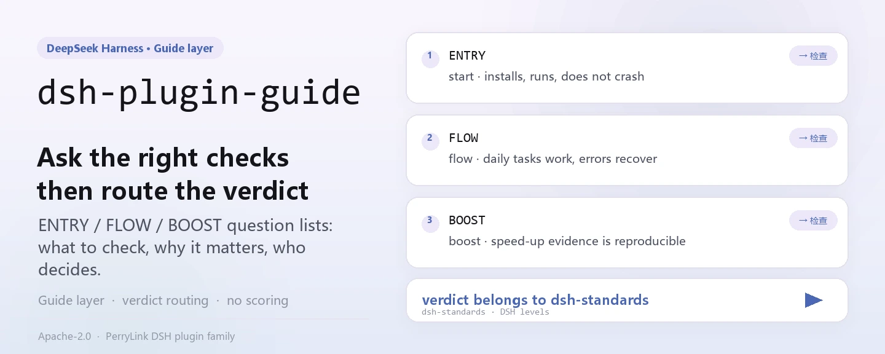
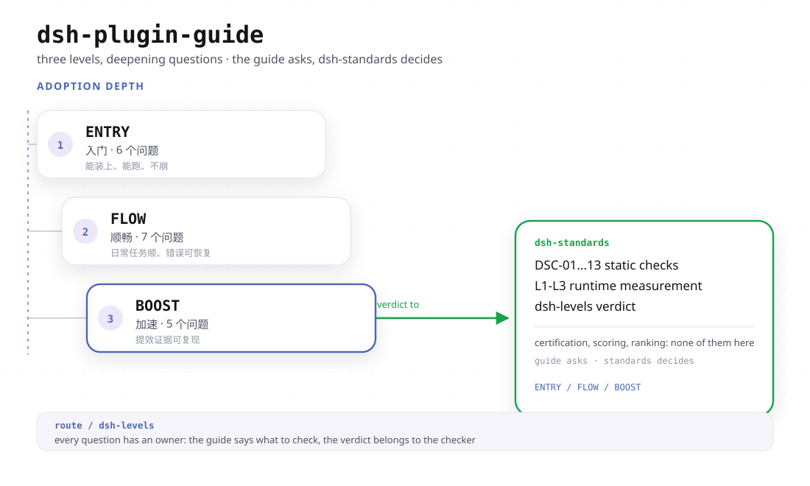

<div align="center">

<picture>
  <source media="(prefers-color-scheme: dark)" srcset="docs/assets/dsh-plugin-guide-hero-en-dark.webp">
  
</picture>

# dsh-plugin-guide

**Ask the right question before you build: pin down a DSH plugin's ENTRY / FLOW / BOOST layers, then hand the verdict to the tool that actually runs the checks.**

The guide layer for DSH plugins — it explains what to check, why it matters, and which tool owns the verdict; it never certifies, scores, or ranks, it only routes checks to `dsh-standards`.

[Install](#three-step-setup) · [Configuration](#configuration) · [FAQ](#faq) · [简体中文](README.md) · [English](README.en.md) · [Español](README.es.md) · [Português](README.pt.md) · [हिन्दी](README.hi.md)

[](LICENSE)
[](#compatibility)
[](https://www.npmjs.com/package/dsh-plugin-guide)
[](https://github.com/PerryLink/dsh-plugin-guide/actions/workflows/verify.yml)
[](#compatibility)

[](https://github.com/PerryLink/dsh-plugin-guide/stargazers)
[](https://www.npmjs.com/package/dsh-plugin-guide)
[](https://gitee.com/perrylink/dsh-plugin-guide)

```sh
dsh plugin --profile web add dsh-plugin-guide
```

</div>

<sub>Community guide, not affiliated with DeepSeek; not a certification, not a ranking, not a security audit. Canonical repository: <https://github.com/PerryLink/dsh-plugin-guide> (Gitee is a read-only snapshot).</sub>

## What it is

`dsh-plugin-guide` is the **guide layer** for DSH plugins: it explains what to check, why it matters, and which tool owns the verdict. Once installed it registers one on-demand agent skill whose body is `SKILL.md`; that body's relative references (`./docs/...`) resolve into this package through a directory `resourceBase`. It does not certify, score, or rank: checks live in `dsh-standards`, the rule text lives in `dsh-plugin-spec`, and build/scaffold work belongs to `dsh-primer`.

| Package | Role |
|---|---|
| **`dsh-plugin-guide`** | This package: the prose guide, the three-layer map, the agent skill |
| **`dsh-standards`** | The execution umbrella: ENTRY/FLOW checks, the `dsh-levels` audit, the spec files |
| **`dsh-plugin-spec`** | The low-level rule text and clause source |
| **`dsh-primer`** | The legacy build/scaffold skill and CLI (formerly `dsh-plugin-guide` 0.3.x) |

### Upstream and usage (facts, 2026-11)

- **dsh-plugin-hub** — a version-aware npm metadata check is on main ([`4f3a560`](https://github.com/dshplugin/dsh-plugin-hub/commit/4f3a560), 2026-11-09). Scope: install-time npm metadata only; it does not run ENTRY and is not an endorsement of any plugin or market.
- **Usage** (npm registry, 2026-11): this guide ~12.6k/month, `dsh-standards` ~4.4k/month, `dsh-plugin-start` ~1.65k/month. Downloads are not unique users and are not a ranking, certification, or security claim.
- **Author-side entry points**: `dsh-plugin-start` (scaffolder with the check and an advisory CI snippet in its output) and `dsh-check-action` (read-only ENTRY Action).

<picture>
  <source media="(prefers-color-scheme: dark)" srcset="docs/assets/dsh-plugin-guide-flow-v4-dark.svg">
  
</picture>

## Three-step setup

1. **Install** (pick one channel):

   ```sh
   # git channel (latest main)
   dsh plugin --profile web add github:PerryLink/dsh-plugin-guide
   # npm channel (published releases)
   dsh plugin --profile web add dsh-plugin-guide
   # tarball channel: npm pack in this repo, then
   dsh plugin --profile web add ./dsh-plugin-guide-<version>.tgz
   ```

   No build step: `index.js` is the shipped artifact, and `SKILL.md` plus `docs/` are the skill body.

2. **Ask the agent to use the skill once** (skills load on demand, never as a resident prompt):

   ```text
   > Use dsh-plugin-guide to review ./my-plugin: report the ENTRY verdict first, then say which layers are not-run.
   ```

3. **Verify it took effect**:

   ```sh
   dsh --profile web --dump-config | grep -A2 'id: dsh-plugin-guide'
   ```

   The session skill catalog should list `dsh-plugin-guide`, and the loaded body should point at `docs/levels.md` (the acceptance shape recorded in `package.json#dshWorkshop.capability.expected`).

**Uninstall**: `dsh plugin --profile web remove dsh-plugin-guide` (or delete the row from your profile patch). Registration is a Cordis effect, so unloading removes it and leaves no residue.

## Core capabilities

- **Three-layer map** — ENTRY asks "can it be recognized, installed, and started?", FLOW asks "can a user install, configure, use, upgrade, and remove it?", BOOST asks "does it use Cordis well?". Three tracks, not three grades; they do not add up to a score or a certificate.
- **Check routing** — this package explains and routes only: conformance checks go to `dsh-standards`, the rule text is in `dsh-plugin-spec`, and building a plugin means `dsh-primer` (the old `dsh-plugin-dev` CLI lives there, not here).
- **Evidence rules** — `static` ≠ `runtime`, `recognized` ≠ `pass`, `not-run` ≠ `pass`; a PASS needs a command, an artifact, an environment, and a date — otherwise write `not-run`, `not-measured`, or `incomplete`.
- **On-demand skill** — `index.js` reads `SKILL.md`, strips the YAML frontmatter, and registers it with `source: bundled` and a directory `resourceBase`; the skill enters the context only when asked for, so it adds no resident prompt prefix.
- **No borrowed authority** — no verdicts, no market gate, no official claim; the wording discipline is written down in `SKILL.md` and `STANDARDS.md` and can be checked line by line.

### The three layers

| Layer | Question | Can it produce a verdict? |
|---|---|---|
| **ENTRY** | Can it be recognized, installed, and started? | Yes: recognized / runtime / failed / incomplete / unavailable |
| **FLOW** | Can a user install, configure, use, upgrade, and remove it? | Yes, where runtime evidence exists; otherwise `not-run` |
| **BOOST** | Does it use Cordis well? | No plugin-level verdict; evidence is recorded per practice |

Read the one-page map first: [docs/levels.md](docs/levels.md). Before publishing: [release checklist](docs/release-checklist.md).

### Running the checks

```sh
# ENTRY recognition only (no runtime claim)
npx dsh-standards ./my-plugin --scope entry --entry-claim static

# Three-layer audit; unrun layers stay not-run / not-measured
npx -p dsh-standards dsh-levels ./my-plugin --format json
```

`recognized` is not a pass, `static` is not a pass, and `not-run` is not a pass either. Exit codes: `0` completed, `1` attributable FAIL, `2` incomplete/not-run, `3` usage error — a `not-run` or `incomplete` result must never be written as a pass (see [docs/entry.md](docs/entry.md)).

### What changed in 0.4.0

- The previous agent skill and the `dsh-plugin-dev` CLI moved to [`dsh-primer`](https://github.com/PerryLink/dsh-primer).
- This package is now the **guide** layer: three-layer map, check routing, and evidence rules.
- The old 0.3.x npm versions are deprecated and remain available for existing installs. The 0.4.0 line is a breaking product change; users pinned to `^0.3` will not auto-upgrade.
- Checks live in [`dsh-standards`](https://github.com/PerryLink/dsh-standards), not in this package.

## Configuration

This package has no Schemastery `Config`: `cordis.patch.yml` only `insert`s one row, and the plugin reads no `config.*` key at all. The only things you can adjust are that row and the profile it lives in.

| Key | Default | Meaning |
|---|---|---|
| `id` | `dsh-plugin-guide` | Row identifier; a later patch layer overrides this row by `id` (whole-row replacement) |
| `name` | `dsh-plugin-guide` | The module the loader imports (`package.json#main` → `index.js`) |
| `config` | not accepted | This package reads no config keys; anything written here has no effect |

<details>
<summary>Full patch file (cordis.patch.yml, 9 lines)</summary>

```yaml
# dsh-plugin-guide bundle layer: register the packaged knowledge base as an agent skill.
# This file is the `dsh.bundle.patch` layer (see package.json#dsh.bundle.patch).
# Layer semantics: a YAML array of row verbs; `insert` adds plugin rows to the
# composed config. Later layers override a row by `id` (whole-config replacement).
- insert:
    # `id`: stable row identifier used by later layers to override this row.
    - id: dsh-plugin-guide
      # `name`: the module the loader imports; resolves to this package's entry (package.json#main → index.js).
      name: dsh-plugin-guide
```

</details>

To turn it off: delete that row from the profile patch, or run `dsh plugin --profile web remove dsh-plugin-guide`.

## FAQ

<details>
<summary>Will it decide whether my plugin is good enough?</summary>

No. This package is the guide layer, not the judge: it explains the three layers, routes checks to `dsh-standards`, and states the evidence rules. BOOST has no plugin-level pass/fail either — a practice can carry evidence, but a plugin never gets a "BOOST level".

</details>

<details>
<summary>Does a `recognized` or `static` result count as a pass?</summary>

No. `recognized` only means the package shape can be identified and `static` only means a static preflight ran; `static` ≠ `runtime` and `not-run` ≠ `pass`. When FLOW has run only a few journeys the status is `not-run`, never a soft pass — and a FLOW pass rate or grade must not be published either.

</details>

<details>
<summary>Will installing it touch my profile or my other plugins?</summary>

No. It registers exactly one skill with the `skills` service (name `dsh-plugin-guide`, `source: bundled`), wrapped in `ctx.effect()` so unloading or hot-reloading removes it; it registers no tools, commands, client slots, or `webServer` prefix, makes no network requests, and declares only the `filesystem:read` permission.

</details>

<details>
<summary>What about existing 0.3.x users?</summary>

0.3.x is deprecated but still installable; 0.4.0 is a product switch, so a profile pinned to `^0.3` will not auto-upgrade. The legacy build/scaffold skill and the `dsh-plugin-dev` CLI now belong to [`dsh-primer`](https://github.com/PerryLink/dsh-primer); this package keeps only the guide and the routing.

</details>

<details>
<summary>Where do the checker and the rule text actually live?</summary>

The checker and the three-layer audit live in [`dsh-standards`](https://www.npmjs.com/package/dsh-standards) (`npx dsh-standards`, `npx -p dsh-standards dsh-levels`); the rule text lives in [`dsh-plugin-spec`](https://github.com/PerryLink/dsh-plugin-spec). The `dsh.standards` placeholder in this package's `package.json` still reads entry/flow = `not-run`, boost = `not-measured`, `evidence: null` — that means "not measured", not "passed".

</details>

## Security boundaries

- No official endorsement, certification, accreditation, or security audit.
- No score, ranking, or market gate.
- No fabricated runtime evidence: `static` ≠ `runtime`, `not-run` ≠ `pass`.
- BOOST is advice and evidence, never a plugin grade.
- **The text is the boundary.** The guide only states what it can point at a source document for; a practice that cannot be measured (developer hours, maintenance cost) is recorded as a WARN or a note, never as an invented number (see [docs/boost.md](docs/boost.md)).
- **Non-official by construction.** No certification, accreditation, security audit, ranking, or market gate; the outward wording avoids official / certified / secure / recommended / ranked claims (see [STANDARDS.md](STANDARDS.md)).

## Permissions & data

- **Permissions**: `package.json#dshWorkshop.permissions` declares only `filesystem:read`. At `apply()` time the plugin reads the packaged `SKILL.md`, and the skill body's relative references resolve into the package's `docs/` through the directory `resourceBase`.
- **Data**: nothing is written to the workspace or anywhere outside the profile; no telemetry, analytics, advertising, or hosted account is added, and no data is sent to PerryLink (see [PRIVACY.md](PRIVACY.md)). The host's own session/log storage and its retention are controlled by the host.
- **Uninstall**: removing the package deletes its code only — not host logs, workspace files, or documents you already produced.

## Known limitations

- **The guide produces no verdict.** It has no judge capability: it can neither mark a plugin pass nor mark it fail; a verdict comes only from a result `dsh-standards` actually ran.
- **The FLOW runtime is still a draft.** J1/J2/J4/J6 have runtime evidence on fixtures; J3/J7 only reach fixture-level runtime; J5/J8 have static preflight only; browser rendering is not covered yet — so "only a few journeys ran" must be written as `not-run` (see [docs/flow.md](docs/flow.md)).
- **BOOST's measured examples are fixtures or synthetic captures.** They are not production baselines; LEV-3, LEV-6, and LEV-7 have the strongest evidence, the others only loader/context-level fixtures; without evidence the status is `not-measured` (see [docs/boost.md](docs/boost.md)).
- **The rules track the host.** The baseline is DSH `0.2.2-alpha.3` / Cordis `4.0.6-alpha.2` as of 2026-11-04; Node has required `>=24.9.0` since `0.2.2-alpha.2`; `ctx.menus` is gone in `0.2.2-alpha.3`; and since `0.2.1-alpha.4` the declared `engines.dsh` decides the version corridor alone (see [docs/levels.md](docs/levels.md)).
- **The `dsh.standards` placeholder is not a score.** In `package.json`, entry/flow = `not-run`, boost = `not-measured`, `evidence: null` — a placeholder only.
- **0.3.x stays on the old shape.** 0.3.x is a deprecated product line; the build/scaffold capability now lives in `dsh-primer`, and this package ships no CLI.

## Interoperability with other DSH plugins

This plugin **does not interfere** with other plugins:

- **No tool, command, or service-key collision.** It registers no tools, commands, or service keys, so it owns no bare names and cannot collide on a service key.
- **No slot or HTTP route collision.** It registers no client slot key and no `webServer` prefix.
- **The only dependency is the `skills` service.** `export const inject = ['skills']`, provided by the host; it does not import the host implementation, it only consumes that service.
- **No shared event listeners.** It does not listen on ordering-sensitive events such as `agent/pre-step` or `tools/post-execute`, so there is no waterfall chain to short-circuit.
- **No patch-layer collision.** The bundle patch only `insert`s its own row; it never overrides a built-in row's `config`.
- **No global mutation.** It patches no prototypes, rewrites no `process.env`, and replaces no global fetch dispatcher.
- **Registration is an effect.** `ctx.effect(() => ctx.skills.register(...))` — stop or hot-reload removes the contribution.

Baseline: DSH `0.2.2-alpha.3` / Cordis `4.0.6-alpha.2` (as recorded in [docs/levels.md](docs/levels.md), 2026-11-04).

## Compatibility

| Surface | Status |
|---|---|
| Harness | `engines.dsh` = `>=0.2.2-0 <0.3.0` (since `0.2.1-alpha.4`, `engines.dsh` decides alone; npm's default semver needs an explicit `^0.2.2-alpha.3` union arm). Baseline DSH `0.2.2-alpha.3` (npm `alpha`), Cordis `4.0.6-alpha.2`. |
| Node | `>=24.9.0` (the 0.2.2 line's requirement, since `0.2.2-alpha.2`) |
| Platforms | Anywhere DSH runs (plain-text skill; no browser half, no native extension) |
| Model | No model calls: the host injects the skill text into context, so no extra model capability is required |

## Ecosystem & quality

- [npm package page](https://www.npmjs.com/package/dsh-plugin-guide) (published releases, `0.4.3`)
- [Gitee mirror](https://gitee.com/perrylink/dsh-plugin-guide) (read-only snapshot; GitHub is canonical)
- [dsh-standards](https://www.npmjs.com/package/dsh-standards) (the checker and the `dsh-levels` three-layer audit)
- [dsh-plugin-spec](https://github.com/PerryLink/dsh-plugin-spec) (the low-level rule text and clause source)
- [dsh-primer](https://github.com/PerryLink/dsh-primer) (the legacy build/scaffold skill and CLI)
- Repository docs: [the three layers](docs/levels.md) · [ENTRY](docs/entry.md) · [FLOW](docs/flow.md) · [BOOST](docs/boost.md)
- Repository governance: [CHANGELOG](CHANGELOG.md) · [STANDARDS.md](STANDARDS.md) · [CONTRIBUTING](CONTRIBUTING.md)

## Development

```sh
npm test                                # node --test tests/*.test.mjs
npm run test:pack                       # npm pack --dry-run
python scripts/gen-readme-assets.py     # regenerate the light/dark hero SVGs in docs/assets (Python + Pillow)
```

No build step: `index.js` is the shipped artifact. CI is [.github/workflows/verify.yml](.github/workflows/verify.yml) (a Node 22 and 24 matrix running the unit tests plus `npm pack --dry-run`). The README images are generated programmatically by [scripts/gen-readme-assets.py](scripts/gen-readme-assets.py); re-running it is idempotent and overwrites in place.

| Path | Purpose |
|---|---|
| `index.js` | The single host face: reads `SKILL.md`, strips the frontmatter, registers the skill through `ctx.effect` |
| `SKILL.md` | The skill body and its `description` (YAML frontmatter) |
| `docs/` | The three-layer map and the ENTRY/FLOW/BOOST guides the skill body references |
| `locale/` | The skill's zh/en display metadata (`meta.title`, `meta.description`) |
| `cordis.patch.yml` | The bundle patch layer; `insert`s only its own row |
| `tests/` | `node --test`: skill frontmatter parsing and registration |
| `scripts/gen-readme-assets.py` | Programmatic image generation (Python + Pillow) |
| `STANDARDS.md` · `NOTICE.md` · `PRIVACY.md` | Standards status, NOTICE, privacy statement |

## Family & thanks

This project is part of the DeepSeek Harness plugin family from [PerryLink](https://github.com/PerryLink) (all Apache-2.0). If this guide is useful, **a star helps the next person find it** — nothing is gated behind it.

- [@PerryLink](https://github.com/PerryLink) — creator and maintainer: the three-layer map and the ENTRY/FLOW/BOOST guide text, the `SKILL.md` skill, the bundle patch layer, and the five-language docs.

<details>
<summary>Expand all plugins</summary>

| Plugin | Status |
|---|---|
| **[dsh-aqua-input-check](https://github.com/PerryLink/dsh-aqua-input-check)** |  |
| **[dsh-archive-check](https://github.com/PerryLink/dsh-archive-check)** |  |
| **[dsh-auto-review](https://github.com/PerryLink/dsh-auto-review)** |  |
| **[dsh-autotier](https://github.com/PerryLink/dsh-autotier)** | 🧊 FROZEN — see the repo README |
| **[dsh-bid-ca-precheck](https://github.com/PerryLink/dsh-bid-ca-precheck)** |  |
| **[dsh-bid-qual-check](https://github.com/PerryLink/dsh-bid-qual-check)** |  |
| **[dsh-cert-mcp](https://github.com/PerryLink/dsh-cert-mcp)** | 🧊 FROZEN — see the repo README |
| **[dsh-checkpoint-rewind](https://github.com/PerryLink/dsh-checkpoint-rewind)** |  |
| **[dsh-click](https://github.com/PerryLink/dsh-click)** |  |
| **[dsh-composer-history](https://github.com/PerryLink/dsh-composer-history)** |  |
| **[dsh-contract-stance](https://github.com/PerryLink/dsh-contract-stance)** |  |
| **[dsh-customs-doc-check](https://github.com/PerryLink/dsh-customs-doc-check)** |  |
| **[dsh-data-quality](https://github.com/PerryLink/dsh-data-quality)** | 🧊 FROZEN — see the repo README |
| **[dsh-demurrage-ledger](https://github.com/PerryLink/dsh-demurrage-ledger)** |  |
| **[dsh-doublecheck](https://github.com/PerryLink/dsh-doublecheck)** |  |
| **[dsh-drill-script-check](https://github.com/PerryLink/dsh-drill-script-check)** |  |
| **[dsh-eia-guide-check](https://github.com/PerryLink/dsh-eia-guide-check)** |  |
| **[dsh-emergency-plan](https://github.com/PerryLink/dsh-emergency-plan)** |  |
| **[dsh-essay-rubric-check](https://github.com/PerryLink/dsh-essay-rubric-check)** |  |
| **[dsh-evidence-check](https://github.com/PerryLink/dsh-evidence-check)** |  |
| **[dsh-export-ctl-check](https://github.com/PerryLink/dsh-export-ctl-check)** |  |
| **[dsh-fast](https://github.com/PerryLink/dsh-fast)** |  |
| **[dsh-fmea-table-check](https://github.com/PerryLink/dsh-fmea-table-check)** |  |
| **[dsh-forecast-penalty](https://github.com/PerryLink/dsh-forecast-penalty)** |  |
| **[dsh-fund-research](https://github.com/PerryLink/dsh-fund-research)** |  |
| **[dsh-github](https://github.com/PerryLink/dsh-github)** |  |
| **[dsh-gongwen-flow-check](https://github.com/PerryLink/dsh-gongwen-flow-check)** |  |
| **[dsh-gongwen-word-check](https://github.com/PerryLink/dsh-gongwen-word-check)** |  |
| **[dsh-guard-plan-qc](https://github.com/PerryLink/dsh-guard-plan-qc)** |  |
| **[dsh-hazchem-check](https://github.com/PerryLink/dsh-hazchem-check)** |  |
| **[dsh-hazplan-check](https://github.com/PerryLink/dsh-hazplan-check)** |  |
| **[dsh-hidden-risk-map](https://github.com/PerryLink/dsh-hidden-risk-map)** |  |
| **[dsh-hs-classify](https://github.com/PerryLink/dsh-hs-classify)** |  |
| **[dsh-icd-rule-check](https://github.com/PerryLink/dsh-icd-rule-check)** |  |
| **[dsh-industry-research](https://github.com/PerryLink/dsh-industry-research)** |  |
| **[dsh-lawcite-adapter](https://github.com/PerryLink/dsh-lawcite-adapter)** |  |
| **[dsh-laya](https://github.com/PerryLink/dsh-laya)** |  |
| **[dsh-lc-doc-check](https://github.com/PerryLink/dsh-lc-doc-check)** |  |
| **[dsh-learning-gap-check](https://github.com/PerryLink/dsh-learning-gap-check)** |  |
| **[dsh-library](https://github.com/PerryLink/dsh-library)** |  |
| **[dsh-local-ai](https://github.com/PerryLink/dsh-local-ai)** |  |
| **[dsh-lsp-actions](https://github.com/PerryLink/dsh-lsp-actions)** |  |
| **[dsh-mask](https://github.com/PerryLink/dsh-mask)** |  |
| **[dsh-mcp-panel](https://github.com/PerryLink/dsh-mcp-panel)** |  |
| **[dsh-medrec-qc](https://github.com/PerryLink/dsh-medrec-qc)** |  |
| **[dsh-memento](https://github.com/PerryLink/dsh-memento)** | 🧊 FROZEN — see the repo README |
| **[dsh-nsfc-form-check](https://github.com/PerryLink/dsh-nsfc-form-check)** |  |
| **[dsh-nurse-record-check](https://github.com/PerryLink/dsh-nurse-record-check)** |  |
| **[dsh-observe](https://github.com/PerryLink/dsh-observe)** |  |
| **[dsh-origin-rvc-check](https://github.com/PerryLink/dsh-origin-rvc-check)** |  |
| **[dsh-ota-review-check](https://github.com/PerryLink/dsh-ota-review-check)** |  |
| **[dsh-output-styles](https://github.com/PerryLink/dsh-output-styles)** |  |
| **[dsh-paper-doc-adapter](https://github.com/PerryLink/dsh-paper-doc-adapter)** |  |
| **[dsh-permission-rules](https://github.com/PerryLink/dsh-permission-rules)** |  |
| **[dsh-permit-report-check](https://github.com/PerryLink/dsh-permit-report-check)** |  |
| **[dsh-pipeline-check](https://github.com/PerryLink/dsh-pipeline-check)** |  |
| **[dsh-pleading-draft](https://github.com/PerryLink/dsh-pleading-draft)** |  |
| **[dsh-plugin-doctor](https://github.com/PerryLink/dsh-plugin-doctor)** | 🚫 RETIRED (repo archived) |
| **[dsh-plugin-guide](https://github.com/PerryLink/dsh-plugin-guide)** |  |
| **[dsh-plugin-kit](https://github.com/PerryLink/dsh-plugin-kit)** | 🚫 RETIRED (repo archived) |
| **[dsh-plugin-upgrade](https://github.com/PerryLink/dsh-plugin-upgrade)** | 🚫 RETIRED (repo archived) |
| **[dsh-policy-brief-draft](https://github.com/PerryLink/dsh-policy-brief-draft)** |  |
| **[dsh-power-loss-split](https://github.com/PerryLink/dsh-power-loss-split)** |  |
| **[dsh-power-ticket-check](https://github.com/PerryLink/dsh-power-ticket-check)** |  |
| **[dsh-ppap-check](https://github.com/PerryLink/dsh-ppap-check)** |  |
| **[dsh-protest-deadline](https://github.com/PerryLink/dsh-protest-deadline)** |  |
| **[dsh-railway-window](https://github.com/PerryLink/dsh-railway-window)** |  |
| **[dsh-repair-order-qc](https://github.com/PerryLink/dsh-repair-order-qc)** |  |
| **[dsh-research-report](https://github.com/PerryLink/dsh-research-report)** |  |
| **[dsh-review-reply-check](https://github.com/PerryLink/dsh-review-reply-check)** |  |
| **[dsh-rulefile-check](https://github.com/PerryLink/dsh-rulefile-check)** |  |
| **[dsh-safety-brief-check](https://github.com/PerryLink/dsh-safety-brief-check)** |  |
| **[dsh-score](https://github.com/PerryLink/dsh-score)** | 🧊 FROZEN — see the repo README |
| **[dsh-session-sync](https://github.com/PerryLink/dsh-session-sync)** |  |
| **[dsh-site-log-check](https://github.com/PerryLink/dsh-site-log-check)** |  |
| **[dsh-skill-pack-security](https://github.com/PerryLink/dsh-skill-pack-security)** |  |
| **[dsh-soe-decision-check](https://github.com/PerryLink/dsh-soe-decision-check)** |  |
| **[dsh-soilwater-check](https://github.com/PerryLink/dsh-soilwater-check)** |  |
| **[dsh-sop-sync-check](https://github.com/PerryLink/dsh-sop-sync-check)** |  |
| **[dsh-spc-gbt-adapter](https://github.com/PerryLink/dsh-spc-gbt-adapter)** |  |
| **[dsh-talk](https://github.com/PerryLink/dsh-talk)** |  |
| **[dsh-tender-extract](https://github.com/PerryLink/dsh-tender-extract)** |  |
| **[dsh-tender-matrix](https://github.com/PerryLink/dsh-tender-matrix)** |  |
| **[dsh-test-drive](https://github.com/PerryLink/dsh-test-drive)** |  |
| **[dsh-ticktick](https://github.com/PerryLink/dsh-ticktick)** | 🚫 RETIRED (repo archived) |
| **[dsh-translate](https://github.com/PerryLink/dsh-translate)** |  |
| **[dsh-warranty-calc](https://github.com/PerryLink/dsh-warranty-calc)** |  |
| **[dsh-budget](https://github.com/PerryLink/dsh-budget)** | 🧊 FROZEN — see the repo README |
| **[dsh-claude-move](https://github.com/PerryLink/dsh-claude-move)** | 🧊 FROZEN — see the repo README |
| **[dsh-defend](https://github.com/PerryLink/dsh-defend)** | 🧊 FROZEN — see the repo README |
| **[dsh-draw](https://github.com/PerryLink/dsh-draw)** | 🧊 FROZEN — see the repo README |
| **[dsh-reach](https://github.com/PerryLink/dsh-reach)** | 🧊 FROZEN — see the repo README |
| **[dsh-background-agents](https://github.com/PerryLink/dsh-background-agents)** | 🚫 RETIRED (repo archived) |
| **[dsh-session-pin](https://github.com/PerryLink/dsh-session-pin)** | 🚫 RETIRED (repo archived) |
| **[dsh-team-rooms](https://github.com/PerryLink/dsh-team-rooms)** | 🚫 RETIRED (repo archived) |

</details>

## License

[LICENSE](LICENSE) (Apache License 2.0) © 2026 dsh-plugin-guide contributors

<p align="center"><sub>Apache-2.0 · Community guide, not affiliated with DeepSeek.</sub></p>
