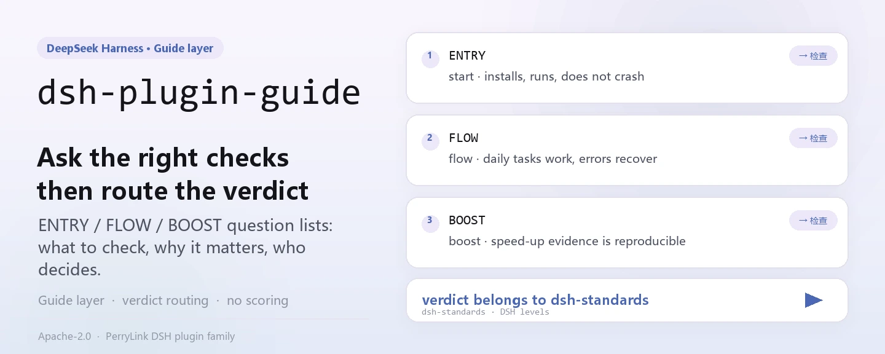
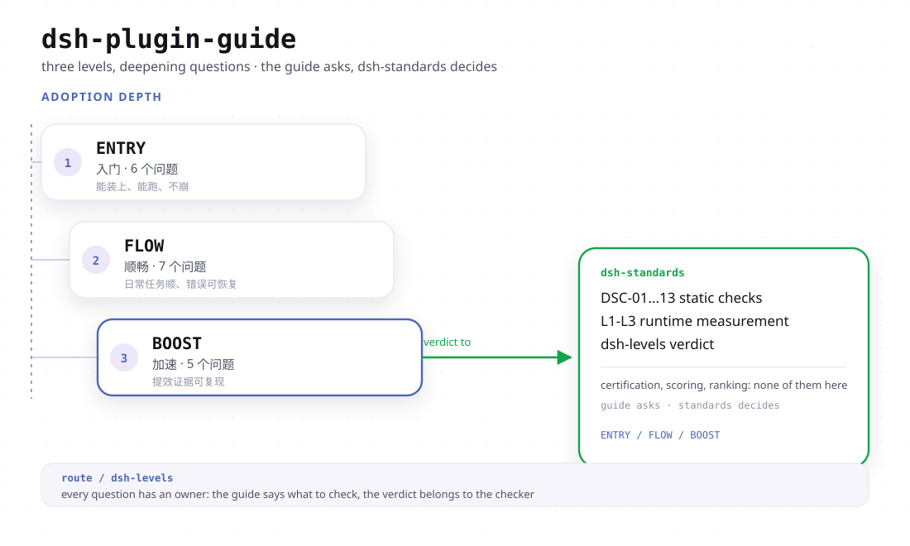

<div align="center">

<picture>
  <source media="(prefers-color-scheme: dark)" srcset="docs/assets/dsh-plugin-guide-hero-en-dark.webp">
  
</picture>

# dsh-plugin-guide

**Haz la pregunta correcta antes de construir: aclara las capas ENTRY / FLOW / BOOST de un plugin DSH y deja el veredicto a la herramienta que ejecuta las comprobaciones.**

La capa de guía para plugins de DSH: explica qué comprobar, por qué importa y a qué herramienta pertenece el veredicto; no certifica, no puntúa y no clasifica, solo enruta las comprobaciones a `dsh-standards`.

[Instalar](#instalación-en-tres-pasos) · [Configuración](#configuración) · [FAQ](#faq) · [简体中文](README.md) · [English](README.en.md) · [Español](README.es.md) · [Português](README.pt.md) · [हिन्दी](README.hi.md)

[](LICENSE)
[](#compatibilidad)
[](https://www.npmjs.com/package/dsh-plugin-guide)
[](https://github.com/PerryLink/dsh-plugin-guide/actions/workflows/verify.yml)
[](#compatibilidad)

[](https://github.com/PerryLink/dsh-plugin-guide/stargazers)
[](https://www.npmjs.com/package/dsh-plugin-guide)
[](https://gitee.com/perrylink/dsh-plugin-guide)

```sh
dsh plugin --profile web add dsh-plugin-guide
```

</div>

<sub>Guía de la comunidad, sin relación con DeepSeek; no es una certificación, ni una clasificación, ni una auditoría de seguridad. Repositorio canónico: <https://github.com/PerryLink/dsh-plugin-guide> (Gitee es una instantánea de solo lectura).</sub>

## Qué es

`dsh-plugin-guide` es la **capa de guía** para plugins de DSH: explica qué comprobar, por qué importa y a qué herramienta pertenece el veredicto. Al instalarse registra una skill de agente que se carga bajo demanda y cuyo cuerpo es `SKILL.md`; las referencias relativas de ese cuerpo (`./docs/...`) se resuelven dentro del paquete mediante un `resourceBase` de tipo directorio. No certifica, no puntúa y no clasifica: las comprobaciones están en `dsh-standards`, el texto de las reglas en `dsh-plugin-spec` y la construcción/andamiaje en `dsh-primer`.

| Paquete | Rol |
|---|---|
| **`dsh-plugin-guide`** | Este paquete: la guía en prosa, el mapa de tres capas y la skill de agente |
| **`dsh-standards`** | El paraguas de ejecución: comprobaciones ENTRY/FLOW, auditoría `dsh-levels` y los archivos de especificación |
| **`dsh-plugin-spec`** | El texto de reglas de bajo nivel y la fuente de las cláusulas |
| **`dsh-primer`** | La skill y CLI heredadas de construcción/andamiaje (antiguo `dsh-plugin-guide` 0.3.x) |

<picture>
  <source media="(prefers-color-scheme: dark)" srcset="docs/assets/dsh-plugin-guide-flow-v4-dark.svg">
  
</picture>

## Instalación en tres pasos

1. **Instalar** (elige un canal):

   ```sh
   # canal git (último main)
   dsh plugin --profile web add github:PerryLink/dsh-plugin-guide
   # canal npm (versiones publicadas)
   dsh plugin --profile web add dsh-plugin-guide
   # canal tarball: tras npm pack en este repositorio
   dsh plugin --profile web add ./dsh-plugin-guide-<version>.tgz
   ```

   Sin paso de compilación: `index.js` es el artefacto publicado, y `SKILL.md` más `docs/` son el cuerpo de la skill.

2. **Pedir la skill una vez** (las skills se cargan bajo demanda, nunca como prompt residente):

   ```text
   > Usa dsh-plugin-guide para revisar ./my-plugin: primero el veredicto ENTRY y luego qué capas están not-run.
   ```

3. **Verificar que surte efecto**:

   ```sh
   dsh --profile web --dump-config | grep -A2 'id: dsh-plugin-guide'
   ```

   El catálogo de skills de la sesión debe listar `dsh-plugin-guide`, y el cuerpo cargado debe apuntar a `docs/levels.md` (la forma de aceptación registrada en `package.json#dshWorkshop.capability.expected`).

**Desinstalar**: `dsh plugin --profile web remove dsh-plugin-guide` (o borra la fila del patch del perfil). El registro es un efecto de Cordis, así que descargar el plugin lo retira sin dejar residuos.

## Capacidades clave

- **Mapa de tres capas** — ENTRY pregunta «¿se puede reconocer, instalar y arrancar?», FLOW pregunta «¿puede el usuario instalarlo, configurarlo, usarlo, actualizarlo y desinstalarlo?» y BOOST pregunta «¿usa bien Cordis?». Tres pistas, no tres notas; juntas no suman una puntuación ni un certificado.
- **Enrutado de comprobaciones** — este paquete solo explica y enruta: las comprobaciones de conformidad van a `dsh-standards`, el texto de reglas está en `dsh-plugin-spec` y construir un plugin es cosa de `dsh-primer` (la antigua CLI `dsh-plugin-dev` vive allí, no aquí).
- **Reglas de evidencia** — `static` ≠ `runtime`, `recognized` ≠ `pass`, `not-run` ≠ `pass`; un PASS necesita comando, artefacto, entorno y fecha; si falta algo, se escribe `not-run`, `not-measured` o `incomplete`.
- **Skill bajo demanda** — `index.js` lee `SKILL.md`, quita el frontmatter YAML y lo registra con `source: bundled` y un `resourceBase` de directorio; la skill entra en el contexto solo cuando se pide, así que no añade prefijo residente.
- **Sin autoridad prestada** — sin veredictos, sin puerta de mercado y sin declaración de oficialidad; la disciplina de redacción está escrita en `SKILL.md` y `STANDARDS.md` y se puede revisar línea por línea.

### Las tres capas

| Capa | Pregunta | ¿Puede emitir veredicto? |
|---|---|---|
| **ENTRY** | ¿Se puede reconocer, instalar y arrancar? | Sí: recognized / runtime / failed / incomplete / unavailable |
| **FLOW** | ¿Puede el usuario instalarlo, configurarlo, usarlo, actualizarlo y desinstalarlo? | Sí, solo donde hay evidencia de runtime; si no, `not-run` |
| **BOOST** | ¿Usa bien Cordis? | Sin veredicto a nivel de plugin; la evidencia se registra por práctica |

Lee primero el mapa de una página: [docs/levels.md](docs/levels.md).

### Ejecutar las comprobaciones

```sh
# Solo reconocimiento ENTRY (sin reclamar runtime)
npx dsh-standards ./my-plugin --scope entry --entry-claim static

# Auditoría de tres capas; las capas no ejecutadas siguen not-run / not-measured
npx -p dsh-standards dsh-levels ./my-plugin --format json
```

`recognized` no es un aprobado, `static` no es un aprobado y `not-run` tampoco. Códigos de salida: `0` completado, `1` FAIL atribuible, `2` incompleto/not-run, `3` error de uso; un resultado `not-run` o `incomplete` nunca debe escribirse como aprobado (ver [docs/entry.md](docs/entry.md)).

### Qué cambió en 0.4.0

- La skill de agente anterior y la CLI `dsh-plugin-dev` se mudaron a [`dsh-primer`](https://github.com/PerryLink/dsh-primer).
- Este paquete es ahora la capa de **guía**: mapa de tres capas, enrutado de comprobaciones y reglas de evidencia.
- Las versiones 0.3.x de npm están obsoletas y siguen disponibles para instalaciones existentes. La línea 0.4.0 es un cambio de producto; quien esté fijado a `^0.3` no se actualizará solo.
- Las comprobaciones viven en [`dsh-standards`](https://github.com/PerryLink/dsh-standards), no en este paquete.

## Configuración

Este paquete no tiene `Config` de Schemastery: `cordis.patch.yml` solo `insert`a una fila y el plugin no lee ninguna clave `config.*`. Lo único ajustable son esa fila y el perfil donde vive.

| Clave | Valor por defecto | Significado |
|---|---|---|
| `id` | `dsh-plugin-guide` | Identificador de fila; una capa de patch posterior la sustituye por `id` (reemplazo de fila completa) |
| `name` | `dsh-plugin-guide` | El módulo que importa el loader (`package.json#main` → `index.js`) |
| `config` | no se acepta | Este paquete no lee claves de configuración; lo que se escriba aquí no tiene efecto |

<details>
<summary>Archivo de patch completo (cordis.patch.yml, 9 líneas)</summary>

```yaml
# dsh-plugin-guide bundle layer: register the packaged knowledge base as an agent skill.
# This file is the `dsh.bundle.patch` layer (see package.json#dsh.bundle.patch).
# Layer semantics: a YAML array of row verbs; `insert` adds plugin rows to the
# composed config. Later layers override a row by `id` (whole-config replacement).
- insert:
    # `id`: stable row identifier used by later layers to override this row.
    - id: dsh-plugin-guide
      # `name`: the module the loader imports; resolves to this package's entry (package.json#main → index.js).
      name: dsh-plugin-guide
```

</details>

Para desactivarlo: borra esa fila del patch del perfil o ejecuta `dsh plugin --profile web remove dsh-plugin-guide`.

## FAQ

<details>
<summary>¿Va a decidir si mi plugin es suficientemente bueno?</summary>

No. Este paquete es la capa de guía, no el juez: explica las tres capas, enruta las comprobaciones a `dsh-standards` y enuncia las reglas de evidencia. BOOST tampoco tiene aprobado/suspenso a nivel de plugin: una práctica puede llevar evidencia, pero un plugin nunca recibe un «nivel BOOST».

</details>

<details>
<summary>¿Un resultado `recognized` o `static` cuenta como aprobado?</summary>

No. `recognized` solo significa que la forma del paquete se puede identificar y `static` solo que se hizo una preverificación estática; `static` ≠ `runtime` y `not-run` ≠ `pass`. Cuando FLOW solo ha recorrido unos pocos journeys el estado es `not-run`, nunca un aprobado blando; tampoco se debe publicar una tasa de aprobados ni una nota de FLOW.

</details>

<details>
<summary>¿Instalarlo toca mi perfil o mis otros plugins?</summary>

No. Registra exactamente una skill en el servicio `skills` (nombre `dsh-plugin-guide`, `source: bundled`), envuelta en `ctx.effect()` para que descargar o recargar en caliente la retire; no registra herramientas, comandos, slots de cliente ni prefijo `webServer`, no hace peticiones de red y solo declara el permiso `filesystem:read`.

</details>

<details>
<summary>¿Y los usuarios de 0.3.x?</summary>

0.3.x está obsoleto pero se puede instalar; 0.4.0 es un cambio de producto, así que un perfil fijado a `^0.3` no se actualizará solo. La skill y la CLI heredadas de construcción/andamiaje ahora pertenecen a [`dsh-primer`](https://github.com/PerryLink/dsh-primer); este paquete conserva solo la guía y el enrutado.

</details>

<details>
<summary>¿Dónde están realmente el comprobador y el texto de las reglas?</summary>

El comprobador y la auditoría de tres capas están en [`dsh-standards`](https://www.npmjs.com/package/dsh-standards) (`npx dsh-standards`, `npx -p dsh-standards dsh-levels`); el texto de las reglas está en [`dsh-plugin-spec`](https://github.com/PerryLink/dsh-plugin-spec). El marcador `dsh.standards` del `package.json` de este paquete sigue en entry/flow = `not-run`, boost = `not-measured`, `evidence: null`: eso significa «sin medir», no «aprobado».

</details>

## Límites de seguridad

- Sin aval oficial, certificación, acreditación ni auditoría de seguridad.
- Sin puntuación, clasificación ni puerta de mercado.
- Sin evidencia de runtime inventada: `static` ≠ `runtime`, `not-run` ≠ `pass`.
- BOOST es consejo y evidencia, nunca una nota del plugin.
- **El texto es el límite.** La guía solo afirma lo que puede señalar en un documento fuente; una práctica que no se puede medir (horas de desarrollo, coste de mantenimiento) se registra como WARN o nota, nunca como un número inventado (ver [docs/boost.md](docs/boost.md)).
- **No oficial por construcción.** Sin certificación, acreditación, auditoría de seguridad, clasificación ni puerta de mercado; la redacción evita declaraciones official / certified / secure / recommended / ranked (ver [STANDARDS.md](STANDARDS.md)).

## Permisos y datos

- **Permisos**: `package.json#dshWorkshop.permissions` declara solo `filesystem:read`. En `apply()` el plugin lee el `SKILL.md` empaquetado, y las referencias relativas del cuerpo se resuelven en el `docs/` del paquete mediante el `resourceBase` de directorio.
- **Datos**: no se escribe en el workspace ni fuera del perfil; no se añade telemetría, analítica, publicidad ni cuenta alojada, y no se envían datos a PerryLink (ver [PRIVACY.md](PRIVACY.md)). El almacenamiento de sesiones y logs del host y su retención los controla el host.
- **Desinstalación**: quitar el paquete borra solo su código, no los logs del host, los archivos del workspace ni los documentos que ya hayas producido.

## Limitaciones conocidas

- **La guía no produce veredicto.** No tiene capacidad de juez: no puede marcar un plugin como aprobado ni como suspenso; el veredicto solo sale de un resultado que `dsh-standards` haya ejecutado de verdad.
- **El runtime de FLOW sigue siendo un borrador.** `dsh-flow-collect` genera evidencia `dsh-flow-evidence/2` y cubre los journeys de runtime J1/J2/J4/J6; J3/J5/J7/J8 siguen static o blocked (algunos solo llegan a nivel fixture) y el renderizado en navegador no tiene sonda; por eso «solo se ejecutaron unos pocos journeys» debe escribirse como `not-run` (ver [docs/flow.md](docs/flow.md)).
- **Los ejemplos medidos de BOOST son fixtures o capturas sintéticas.** No son líneas base de producción; LEV-3, LEV-6 y LEV-7 tienen la evidencia más fuerte, el resto solo fixtures de nivel loader/contexto; sin evidencia el estado es `not-measured` (ver [docs/boost.md](docs/boost.md)).
- **Las reglas siguen al host.** La línea base es DSH `0.2.2-rc.3` (npm `next`; `latest` sigue siendo `0.2.2-rc.1`) / Cordis `4.1.0` / Node `>=24.9.0` a fecha 2026-11-14; la línea base histórica del 2026-11-04 era DSH `0.2.2-alpha.3` / Cordis `4.0.6-alpha.2`, y `ctx.menus` desapareció en `0.2.2-alpha.3`; desde `0.2.1-alpha.4` el `engines.dsh` declarado decide solo el corredor de versiones (ver [docs/levels.md](docs/levels.md)).
- **El marcador `dsh.standards` no es una nota.** En `package.json`, entry/flow = `not-run`, boost = `not-measured`, `evidence: null`: solo un marcador.
- **0.3.x se queda con la forma antigua.** 0.3.x es una línea obsoleta; la capacidad de construcción/andamiaje está ahora en `dsh-primer` y este paquete no incluye CLI.

## Interoperabilidad con otros plugins DSH

Este plugin **no interfiere** con otros plugins:

- **Sin colisión de herramientas, comandos ni claves de servicio.** No registra herramientas, comandos ni claves de servicio, así que no ocupa nombres desnudos y no puede colisionar en una clave de servicio.
- **Sin colisión de slots ni de rutas HTTP.** No registra claves de slot de cliente ni prefijo `webServer`.
- **La única dependencia es el servicio `skills`.** `export const inject = ['skills']`, que aporta el host; no importa la implementación del host, solo consume ese servicio.
- **Sin listeners de eventos compartidos.** No escucha eventos sensibles al orden como `agent/pre-step` o `tools/post-execute`, así que no hay cadena waterfall que cortocircuitar.
- **Sin colisión de capas de patch.** El patch del bundle solo `insert`a su propia fila; nunca sobrescribe el `config` de una fila integrada.
- **Sin mutación global.** No parchea prototipos, no reescribe `process.env` y no sustituye el dispatcher fetch global.
- **El registro es un efecto.** `ctx.effect(() => ctx.skills.register(...))`: parar o recargar en caliente retira la contribución.

Línea base: DSH `0.2.2-rc.3` / Cordis `4.1.0` (según [docs/levels.md](docs/levels.md), 2026-11-14; el registro alpha.3 del 2026-11-04 se conserva como histórico).

## Compatibilidad

| Superficie | Estado |
|---|---|
| Harness | `engines.dsh` = `>=0.2.2-0 <0.3.0` (desde `0.2.1-alpha.4`, `engines.dsh` decide solo; el límite inferior debe llevar la etiqueta de prerelease: `>=0.2.2-0` ya incluye `0.2.2-rc.3` con el semver por defecto de npm, mientras que un `^0.2.2` desnudo no lo incluye). Línea base DSH `0.2.2-rc.3` (npm `next`; `latest` sigue siendo `0.2.2-rc.1`), Cordis `4.1.0`. |
| Node | `>=24.9.0` (requisito de la línea 0.2.2, desde `0.2.2-alpha.2`) |
| Plataformas | Donde corra DSH (skill de texto plano; sin mitad de navegador, sin extensión nativa) |
| Modelo | Sin llamadas al modelo: el host inyecta el texto de la skill en el contexto, así que no hace falta capacidad de modelo adicional |

## Ecosistema y calidad

- [Página del paquete en npm](https://www.npmjs.com/package/dsh-plugin-guide) (versiones publicadas, `0.5.8`)
- [Espejo en Gitee](https://gitee.com/perrylink/dsh-plugin-guide) (instantánea de solo lectura; GitHub es la fuente canónica)
- [dsh-standards](https://www.npmjs.com/package/dsh-standards) (el comprobador y la auditoría de tres capas `dsh-levels`)
- [dsh-plugin-spec](https://github.com/PerryLink/dsh-plugin-spec) (el texto de reglas de bajo nivel y la fuente de las cláusulas)
- [dsh-primer](https://github.com/PerryLink/dsh-primer) (la skill y CLI heredadas de construcción/andamiaje)
- Documentos del repositorio: [las tres capas](docs/levels.md) · [ENTRY](docs/entry.md) · [FLOW](docs/flow.md) · [BOOST](docs/boost.md) · [notas del host rc3](docs/rc3-notes.md)
- Gobernanza del repositorio: [CHANGELOG](CHANGELOG.md) · [STANDARDS.md](STANDARDS.md) · [CONTRIBUTING](CONTRIBUTING.md)

## Desarrollo

```sh
npm test                                # node --test tests/*.test.mjs
npm run test:pack                       # npm pack --dry-run
python scripts/gen-readme-assets.py     # regenera los SVG hero claro/oscuro de docs/assets (Python + Pillow)
```

Sin paso de compilación: `index.js` es el artefacto publicado. La CI es [.github/workflows/verify.yml](.github/workflows/verify.yml) (matriz de Node 22 y 24 que ejecuta las pruebas unitarias y `npm pack --dry-run`). Las imágenes del README se generan de forma programática con [scripts/gen-readme-assets.py](scripts/gen-readme-assets.py); volver a ejecutarlo es idempotente y sobrescribe en el sitio.

| Ruta | Función |
|---|---|
| `index.js` | La única cara de host: lee `SKILL.md`, quita el frontmatter y registra la skill con `ctx.effect` |
| `SKILL.md` | El cuerpo de la skill y su `description` (frontmatter YAML) |
| `docs/` | El mapa de tres capas y las guías ENTRY/FLOW/BOOST que referencia el cuerpo |
| `locale/` | Metadatos de presentación zh/en de la skill (`meta.title`, `meta.description`) |
| `cordis.patch.yml` | La capa de patch del bundle; solo `insert`a su propia fila |
| `tests/` | `node --test`: análisis del frontmatter y registro de la skill |
| `scripts/gen-readme-assets.py` | Generación programática de imágenes (Python + Pillow) |
| `STANDARDS.md` · `NOTICE.md` · `PRIVACY.md` | Estado de estándares, NOTICE y declaración de privacidad |

## Familia y agradecimientos

Este proyecto forma parte de la familia de plugins de DeepSeek Harness de [PerryLink](https://github.com/PerryLink) (todos Apache-2.0). Si esta guía te resulta útil, **una estrella ayuda a que la siguiente persona la encuentre**: no hay nada bloqueado tras ella.

- [@PerryLink](https://github.com/PerryLink) — creador y mantenedor: el mapa de tres capas y el texto de las guías ENTRY/FLOW/BOOST, la skill `SKILL.md`, la capa de patch del bundle y la documentación en cinco idiomas.

<details>
<summary>Expandir todos los plugins</summary>

| Plugin | Estado |
|---|---|
| **[dsh-aqua-input-check](https://github.com/PerryLink/dsh-aqua-input-check)** |  |
| **[dsh-archive-check](https://github.com/PerryLink/dsh-archive-check)** |  |
| **[dsh-auto-review](https://github.com/PerryLink/dsh-auto-review)** |  |
| **[dsh-autotier](https://github.com/PerryLink/dsh-autotier)** | 🧊 CONGELADO — ver el README del repo |
| **[dsh-bid-ca-precheck](https://github.com/PerryLink/dsh-bid-ca-precheck)** |  |
| **[dsh-bid-qual-check](https://github.com/PerryLink/dsh-bid-qual-check)** |  |
| **[dsh-cert-mcp](https://github.com/PerryLink/dsh-cert-mcp)** | 🧊 CONGELADO — ver el README del repo |
| **[dsh-checkpoint-rewind](https://github.com/PerryLink/dsh-checkpoint-rewind)** |  |
| **[dsh-click](https://github.com/PerryLink/dsh-click)** |  |
| **[dsh-composer-history](https://github.com/PerryLink/dsh-composer-history)** |  |
| **[dsh-contract-stance](https://github.com/PerryLink/dsh-contract-stance)** |  |
| **[dsh-customs-doc-check](https://github.com/PerryLink/dsh-customs-doc-check)** |  |
| **[dsh-data-quality](https://github.com/PerryLink/dsh-data-quality)** | 🧊 CONGELADO — ver el README del repo |
| **[dsh-demurrage-ledger](https://github.com/PerryLink/dsh-demurrage-ledger)** |  |
| **[dsh-doublecheck](https://github.com/PerryLink/dsh-doublecheck)** |  |
| **[dsh-drill-script-check](https://github.com/PerryLink/dsh-drill-script-check)** |  |
| **[dsh-eia-guide-check](https://github.com/PerryLink/dsh-eia-guide-check)** |  |
| **[dsh-emergency-plan](https://github.com/PerryLink/dsh-emergency-plan)** |  |
| **[dsh-essay-rubric-check](https://github.com/PerryLink/dsh-essay-rubric-check)** |  |
| **[dsh-evidence-check](https://github.com/PerryLink/dsh-evidence-check)** |  |
| **[dsh-export-ctl-check](https://github.com/PerryLink/dsh-export-ctl-check)** |  |
| **[dsh-fast](https://github.com/PerryLink/dsh-fast)** |  |
| **[dsh-fmea-table-check](https://github.com/PerryLink/dsh-fmea-table-check)** |  |
| **[dsh-forecast-penalty](https://github.com/PerryLink/dsh-forecast-penalty)** |  |
| **[dsh-fund-research](https://github.com/PerryLink/dsh-fund-research)** |  |
| **[dsh-github](https://github.com/PerryLink/dsh-github)** |  |
| **[dsh-gongwen-flow-check](https://github.com/PerryLink/dsh-gongwen-flow-check)** |  |
| **[dsh-gongwen-word-check](https://github.com/PerryLink/dsh-gongwen-word-check)** |  |
| **[dsh-guard-plan-qc](https://github.com/PerryLink/dsh-guard-plan-qc)** |  |
| **[dsh-hazchem-check](https://github.com/PerryLink/dsh-hazchem-check)** |  |
| **[dsh-hazplan-check](https://github.com/PerryLink/dsh-hazplan-check)** |  |
| **[dsh-hidden-risk-map](https://github.com/PerryLink/dsh-hidden-risk-map)** |  |
| **[dsh-hs-classify](https://github.com/PerryLink/dsh-hs-classify)** |  |
| **[dsh-icd-rule-check](https://github.com/PerryLink/dsh-icd-rule-check)** |  |
| **[dsh-industry-research](https://github.com/PerryLink/dsh-industry-research)** |  |
| **[dsh-lawcite-adapter](https://github.com/PerryLink/dsh-lawcite-adapter)** |  |
| **[dsh-laya](https://github.com/PerryLink/dsh-laya)** |  |
| **[dsh-lc-doc-check](https://github.com/PerryLink/dsh-lc-doc-check)** |  |
| **[dsh-learning-gap-check](https://github.com/PerryLink/dsh-learning-gap-check)** |  |
| **[dsh-library](https://github.com/PerryLink/dsh-library)** |  |
| **[dsh-local-ai](https://github.com/PerryLink/dsh-local-ai)** |  |
| **[dsh-lsp-actions](https://github.com/PerryLink/dsh-lsp-actions)** |  |
| **[dsh-mask](https://github.com/PerryLink/dsh-mask)** |  |
| **[dsh-mcp-panel](https://github.com/PerryLink/dsh-mcp-panel)** |  |
| **[dsh-medrec-qc](https://github.com/PerryLink/dsh-medrec-qc)** |  |
| **[dsh-memento](https://github.com/PerryLink/dsh-memento)** | 🧊 CONGELADO — ver el README del repo |
| **[dsh-nsfc-form-check](https://github.com/PerryLink/dsh-nsfc-form-check)** |  |
| **[dsh-nurse-record-check](https://github.com/PerryLink/dsh-nurse-record-check)** |  |
| **[dsh-observe](https://github.com/PerryLink/dsh-observe)** |  |
| **[dsh-origin-rvc-check](https://github.com/PerryLink/dsh-origin-rvc-check)** |  |
| **[dsh-ota-review-check](https://github.com/PerryLink/dsh-ota-review-check)** |  |
| **[dsh-output-styles](https://github.com/PerryLink/dsh-output-styles)** |  |
| **[dsh-paper-doc-adapter](https://github.com/PerryLink/dsh-paper-doc-adapter)** |  |
| **[dsh-permission-rules](https://github.com/PerryLink/dsh-permission-rules)** |  |
| **[dsh-permit-report-check](https://github.com/PerryLink/dsh-permit-report-check)** |  |
| **[dsh-pipeline-check](https://github.com/PerryLink/dsh-pipeline-check)** |  |
| **[dsh-pleading-draft](https://github.com/PerryLink/dsh-pleading-draft)** |  |
| **[dsh-plugin-doctor](https://github.com/PerryLink/dsh-plugin-doctor)** | 🚫 RETIRADO (repo archivado) |
| **[dsh-plugin-guide](https://github.com/PerryLink/dsh-plugin-guide)** |  |
| **[dsh-plugin-kit](https://github.com/PerryLink/dsh-plugin-kit)** | 🚫 RETIRADO (repo archivado) |
| **[dsh-plugin-upgrade](https://github.com/PerryLink/dsh-plugin-upgrade)** | 🚫 RETIRADO (repo archivado) |
| **[dsh-policy-brief-draft](https://github.com/PerryLink/dsh-policy-brief-draft)** |  |
| **[dsh-power-loss-split](https://github.com/PerryLink/dsh-power-loss-split)** |  |
| **[dsh-power-ticket-check](https://github.com/PerryLink/dsh-power-ticket-check)** |  |
| **[dsh-ppap-check](https://github.com/PerryLink/dsh-ppap-check)** |  |
| **[dsh-protest-deadline](https://github.com/PerryLink/dsh-protest-deadline)** |  |
| **[dsh-railway-window](https://github.com/PerryLink/dsh-railway-window)** |  |
| **[dsh-repair-order-qc](https://github.com/PerryLink/dsh-repair-order-qc)** |  |
| **[dsh-research-report](https://github.com/PerryLink/dsh-research-report)** |  |
| **[dsh-review-reply-check](https://github.com/PerryLink/dsh-review-reply-check)** |  |
| **[dsh-rulefile-check](https://github.com/PerryLink/dsh-rulefile-check)** |  |
| **[dsh-safety-brief-check](https://github.com/PerryLink/dsh-safety-brief-check)** |  |
| **[dsh-score](https://github.com/PerryLink/dsh-score)** | 🧊 CONGELADO — ver el README del repo |
| **[dsh-session-sync](https://github.com/PerryLink/dsh-session-sync)** |  |
| **[dsh-site-log-check](https://github.com/PerryLink/dsh-site-log-check)** |  |
| **[dsh-skill-pack-security](https://github.com/PerryLink/dsh-skill-pack-security)** |  |
| **[dsh-soe-decision-check](https://github.com/PerryLink/dsh-soe-decision-check)** |  |
| **[dsh-soilwater-check](https://github.com/PerryLink/dsh-soilwater-check)** |  |
| **[dsh-sop-sync-check](https://github.com/PerryLink/dsh-sop-sync-check)** |  |
| **[dsh-spc-gbt-adapter](https://github.com/PerryLink/dsh-spc-gbt-adapter)** |  |
| **[dsh-talk](https://github.com/PerryLink/dsh-talk)** |  |
| **[dsh-tender-extract](https://github.com/PerryLink/dsh-tender-extract)** |  |
| **[dsh-tender-matrix](https://github.com/PerryLink/dsh-tender-matrix)** |  |
| **[dsh-test-drive](https://github.com/PerryLink/dsh-test-drive)** |  |
| **[dsh-ticktick](https://github.com/PerryLink/dsh-ticktick)** | 🚫 RETIRADO (repo archivado) |
| **[dsh-translate](https://github.com/PerryLink/dsh-translate)** |  |
| **[dsh-warranty-calc](https://github.com/PerryLink/dsh-warranty-calc)** |  |
| **[dsh-budget](https://github.com/PerryLink/dsh-budget)** | 🧊 CONGELADO — ver el README del repo |
| **[dsh-claude-move](https://github.com/PerryLink/dsh-claude-move)** | 🧊 CONGELADO — ver el README del repo |
| **[dsh-defend](https://github.com/PerryLink/dsh-defend)** | 🧊 CONGELADO — ver el README del repo |
| **[dsh-draw](https://github.com/PerryLink/dsh-draw)** | 🧊 CONGELADO — ver el README del repo |
| **[dsh-reach](https://github.com/PerryLink/dsh-reach)** | 🧊 CONGELADO — ver el README del repo |
| **[dsh-background-agents](https://github.com/PerryLink/dsh-background-agents)** | 🚫 RETIRADO (repo archivado) |
| **[dsh-session-pin](https://github.com/PerryLink/dsh-session-pin)** | 🚫 RETIRADO (repo archivado) |
| **[dsh-team-rooms](https://github.com/PerryLink/dsh-team-rooms)** | 🚫 RETIRADO (repo archivado) |

</details>

## Licencia

[LICENSE](LICENSE) (Apache License 2.0) © 2026 dsh-plugin-guide contributors

<p align="center"><sub>Apache-2.0 · Guía de la comunidad, no afiliada a DeepSeek.</sub></p>
