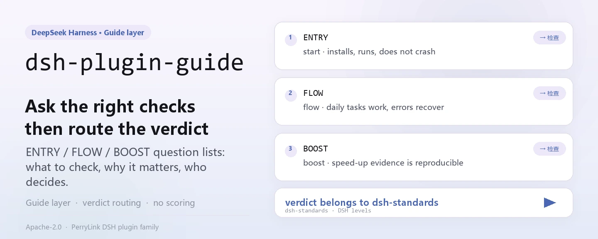
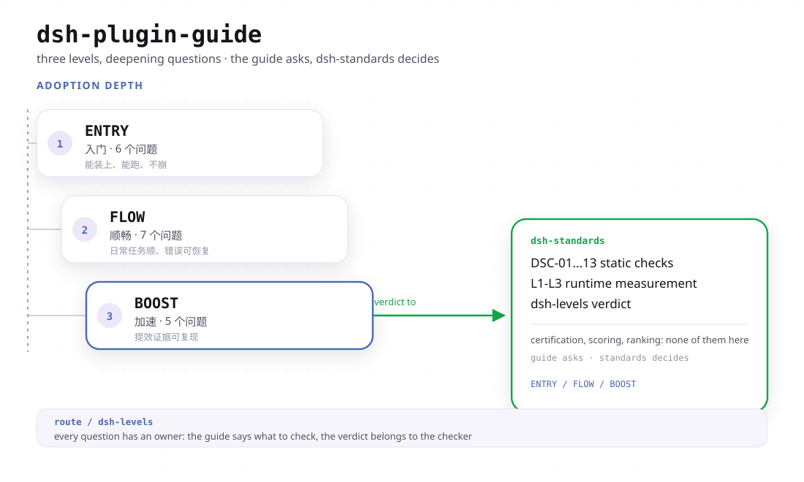

<div align="center">

<picture>
  <source media="(prefers-color-scheme: dark)" srcset="docs/assets/dsh-plugin-guide-hero-en-dark.webp">
  
</picture>

# dsh-plugin-guide

**बनाने से पहले सही सवाल पूछें: किसी DSH प्लगइन की ENTRY / FLOW / BOOST परतें साफ़ करें, और निर्णय उसी टूल को दें जो वास्तव में जाँच चलाता है।**

DSH प्लगइनों के लिए गाइड परत — बताती है क्या जाँचना है, क्यों मायने रखता है, और निर्णय किस टूल का है; यह खुद प्रमाणन, स्कोरिंग या रैंकिंग नहीं करती, बस जाँचें `dsh-standards` तक पहुँचाती है।

[इंस्टॉल](#तीन-चरणों-में-शुरुआत) · [कॉन्फ़िगरेशन](#कॉन्फ़िगरेशन) · [FAQ](#faq) · [简体中文](README.md) · [English](README.en.md) · [Español](README.es.md) · [Português](README.pt.md) · [हिन्दी](README.hi.md)

[](LICENSE)
[](#संगतता)
[](https://www.npmjs.com/package/dsh-plugin-guide)
[](https://github.com/PerryLink/dsh-plugin-guide/actions/workflows/verify.yml)
[](#संगतता)

[](https://github.com/PerryLink/dsh-plugin-guide/stargazers)
[](https://www.npmjs.com/package/dsh-plugin-guide)
[](https://gitee.com/perrylink/dsh-plugin-guide)

```sh
dsh plugin --profile web add dsh-plugin-guide
```

</div>

<sub>समुदाय गाइड, DeepSeek से संबद्ध नहीं; यह प्रमाणन, रैंकिंग या सुरक्षा ऑडिट नहीं है। मुख्य रेपो: <https://github.com/PerryLink/dsh-plugin-guide> (Gitee केवल-पढ़ने वाला स्नैपशॉट है)।</sub>

## यह क्या है

`dsh-plugin-guide` DSH प्लगइनों की **गाइड परत** है: यह बताती है क्या जाँचना है, क्यों मायने रखता है, और निर्णय किस टूल का है। इंस्टॉल होने पर यह माँगने पर लोड होने वाली एक एजेंट स्किल दर्ज करती है जिसका बॉडी `SKILL.md` है; उस बॉडी के सापेक्ष संदर्भ (`./docs/...`) डायरेक्टरी `resourceBase` के ज़रिए इसी पैकेज के अंदर हल होते हैं। यह प्रमाणन नहीं करती, स्कोर नहीं देती और रैंक नहीं करती: जाँचें `dsh-standards` में हैं, नियम-पाठ `dsh-plugin-spec` में, और बिल्ड/स्कैफ़ोल्ड `dsh-primer` का काम है।

| पैकेज | भूमिका |
|---|---|
| **`dsh-plugin-guide`** | यह पैकेज: गद्य गाइड, तीन-परत नक्शा और एजेंट स्किल |
| **`dsh-standards`** | निष्पादन छत्र: ENTRY/FLOW जाँचें, `dsh-levels` ऑडिट और स्पेक फ़ाइलें |
| **`dsh-plugin-spec`** | निम्न-स्तरीय नियम-पाठ और धारा स्रोत |
| **`dsh-primer`** | पुरानी बिल्ड/स्कैफ़ोल्ड स्किल और CLI (पूर्व `dsh-plugin-guide` 0.3.x) |

<picture>
  <source media="(prefers-color-scheme: dark)" srcset="docs/assets/dsh-plugin-guide-flow-v4-dark.svg">
  
</picture>

## तीन चरणों में शुरुआत

1. **इंस्टॉल करें** (कोई एक चैनल चुनें):

   ```sh
   # git चैनल (नवीनतम main)
   dsh plugin --profile web add github:PerryLink/dsh-plugin-guide
   # npm चैनल (प्रकाशित संस्करण)
   dsh plugin --profile web add dsh-plugin-guide
   # tarball चैनल: इस रेपो में npm pack के बाद
   dsh plugin --profile web add ./dsh-plugin-guide-<version>.tgz
   ```

   कोई बिल्ड चरण नहीं: `index.js` ही प्रकाशित आर्टिफ़ैक्ट है, और `SKILL.md` तथा `docs/` ही स्किल बॉडी हैं।

2. **एक बार स्किल माँगें** (स्किलें माँगने पर लोड होती हैं, कभी स्थायी प्रॉम्प्ट नहीं):

   ```text
   > dsh-plugin-guide से ./my-plugin की समीक्षा करें: पहले ENTRY निर्णय, फिर बताएँ कौन-सी परतें not-run हैं।
   ```

3. **प्रभावी हुआ सत्यापित करें**:

   ```sh
   dsh --profile web --dump-config | grep -A2 'id: dsh-plugin-guide'
   ```

   सेशन स्किल कैटलॉग में `dsh-plugin-guide` दिखना चाहिए, और लोड हुआ बॉडी `docs/levels.md` की ओर इशारा करना चाहिए (`package.json#dshWorkshop.capability.expected` में दर्ज स्वीकृति रूप)।

**अनइंस्टॉल**: `dsh plugin --profile web remove dsh-plugin-guide` (या प्रोफ़ाइल पैच से वह पंक्ति हटा दें)। रजिस्ट्रेशन Cordis effect है, इसलिए अनलोड करते ही हट जाता है और कुछ शेष नहीं छोड़ता।

## मुख्य क्षमताएँ

- **तीन-परत नक्शा** — ENTRY पूछती है «क्या इसे पहचाना, इंस्टॉल और शुरू किया जा सकता है?», FLOW पूछती है «क्या उपयोगकर्ता इसे इंस्टॉल, कॉन्फ़िगर, उपयोग, अपग्रेड और हटा सकता है?», और BOOST पूछती है «क्या यह Cordis का अच्छा उपयोग करता है?»। तीन पटरियाँ, तीन श्रेणियाँ नहीं; ये मिलकर स्कोर या प्रमाणपत्र नहीं बनतीं।
- **जाँच रूटिंग** — यह पैकेज केवल समझाता और भेजता है: अनुरूपता जाँचें `dsh-standards` को जाती हैं, नियम-पाठ `dsh-plugin-spec` में है, और प्लगइन बनाना `dsh-primer` का काम है (पुरानी `dsh-plugin-dev` CLI वहीं है, यहाँ नहीं)।
- **साक्ष्य नियम** — `static` ≠ `runtime`, `recognized` ≠ `pass`, `not-run` ≠ `pass`; PASS के लिए कमांड, आर्टिफ़ैक्ट, वातावरण और तारीख चाहिए; कुछ भी छूटे तो `not-run`, `not-measured` या `incomplete` लिखें।
- **माँगने पर स्किल** — `index.js` `SKILL.md` पढ़ता है, YAML frontmatter हटाता है, और `source: bundled` तथा डायरेक्टरी `resourceBase` के साथ दर्ज करता है; स्किल केवल माँगने पर संदर्भ में आती है, इसलिए कोई स्थायी प्रॉम्प्ट उपसर्ग नहीं जोड़ती।
- **उधार का अधिकार नहीं** — कोई निर्णय, कोई मार्केट गेट और कोई आधिकारिक दावा नहीं; शब्द-अनुशासन `SKILL.md` और `STANDARDS.md` में लिखा है और पंक्ति-दर-पंक्ति जाँचा जा सकता है।

### तीन परतें

| परत | सवाल | निर्णय दे सकती है? |
|---|---|---|
| **ENTRY** | क्या इसे पहचाना, इंस्टॉल और शुरू किया जा सकता है? | हाँ: recognized / runtime / failed / incomplete / unavailable |
| **FLOW** | क्या उपयोगकर्ता इसे इंस्टॉल, कॉन्फ़िगर, उपयोग, अपग्रेड और हटा सकता है? | हाँ, केवल जहाँ runtime साक्ष्य हो; अन्यथा `not-run` |
| **BOOST** | क्या यह Cordis का अच्छा उपयोग करता है? | प्लगइन-स्तर का निर्णय नहीं; साक्ष्य प्रति-प्रैक्टिस दर्ज होता है |

पहले एक-पृष्ठ का नक्शा पढ़ें: [docs/levels.md](docs/levels.md)।

### जाँच चलाना

```sh
# केवल ENTRY पहचान (runtime का दावा नहीं)
npx dsh-standards ./my-plugin --scope entry --entry-claim static

# तीन-परत ऑडिट; न चली परतें not-run / not-measured रहती हैं
npx -p dsh-standards dsh-levels ./my-plugin --format json
```

`recognized` उत्तीर्ण नहीं है, `static` उत्तीर्ण नहीं है, और `not-run` भी नहीं। एक्ज़िट कोड: `0` पूर्ण, `1` आरोपणीय FAIL, `2` अपूर्ण/not-run, `3` उपयोग त्रुटि; `not-run` या `incomplete` परिणाम को कभी उत्तीर्ण नहीं लिखना चाहिए (देखें [docs/entry.md](docs/entry.md))।

### 0.4.0 में क्या बदला

- पिछली एजेंट स्किल और `dsh-plugin-dev` CLI [`dsh-primer`](https://github.com/PerryLink/dsh-primer) में चले गए।
- यह पैकेज अब **गाइड** परत है: तीन-परत नक्शा, जाँच रूटिंग और साक्ष्य नियम।
- पुराने 0.3.x npm संस्करण obsoleted हैं और मौजूदा इंस्टॉल के लिए उपलब्ध हैं। 0.4.0 लाइन उत्पाद-परिवर्तन है; `^0.3` पर पिन किए उपयोगकर्ता अपने आप अपग्रेड नहीं होंगे।
- जाँचें [`dsh-standards`](https://github.com/PerryLink/dsh-standards) में हैं, इस पैकेज में नहीं।

## कॉन्फ़िगरेशन

इस पैकेज में Schemastery `Config` नहीं है: `cordis.patch.yml` केवल एक पंक्ति `insert` करता है और प्लगइन कोई `config.*` कुंजी नहीं पढ़ता। समायोज्य केवल वह पंक्ति और वह प्रोफ़ाइल है जिसमें वह रहती है।

| कुंजी | डिफ़ॉल्ट | अर्थ |
|---|---|---|
| `id` | `dsh-plugin-guide` | पंक्ति पहचानकर्ता; बाद की patch परत इस पंक्ति को `id` से बदल देती है (पूरी पंक्ति प्रतिस्थापन) |
| `name` | `dsh-plugin-guide` | वह मॉड्यूल जिसे loader import करता है (`package.json#main` → `index.js`) |
| `config` | स्वीकार नहीं | यह पैकेज कोई कॉन्फ़िगरेशन कुंजी नहीं पढ़ता; यहाँ लिखा कुछ प्रभाव नहीं डालेगा |

<details>
<summary>पूरी पैच फ़ाइल (cordis.patch.yml, 9 पंक्तियाँ)</summary>

```yaml
# dsh-plugin-guide bundle layer: register the packaged knowledge base as an agent skill.
# This file is the `dsh.bundle.patch` layer (see package.json#dsh.bundle.patch).
# Layer semantics: a YAML array of row verbs; `insert` adds plugin rows to the
# composed config. Later layers override a row by `id` (whole-config replacement).
- insert:
    # `id`: stable row identifier used by later layers to override this row.
    - id: dsh-plugin-guide
      # `name`: the module the loader imports; resolves to this package's entry (package.json#main → index.js).
      name: dsh-plugin-guide
```

</details>

बंद करना हो तो: प्रोफ़ाइल पैच से वह पंक्ति हटाएँ, या `dsh plugin --profile web remove dsh-plugin-guide` चलाएँ।

## FAQ

<details>
<summary>क्या यह तय करेगा कि मेरा प्लगइन पर्याप्त अच्छा है?</summary>

नहीं। यह पैकेज गाइड परत है, न्यायाधीश नहीं: यह तीन परतें समझाता है, जाँचें `dsh-standards` तक भेजता है और साक्ष्य नियम बताता है। BOOST का भी प्लगइन-स्तर पर उत्तीर्ण/अनुत्तीर्ण नहीं है: किसी प्रैक्टिस के साथ साक्ष्य हो सकता है, पर प्लगइन को कभी «BOOST स्तर» नहीं मिलता।

</details>

<details>
<summary>क्या `recognized` या `static` परिणाम उत्तीर्ण माना जाता है?</summary>

नहीं। `recognized` का अर्थ केवल यह है कि पैकेज का रूप पहचाना जा सकता है और `static` का अर्थ केवल यह कि स्थिर पूर्व-जाँच हुई; `static` ≠ `runtime` और `not-run` ≠ `pass`। जब FLOW में केवल कुछ journeys चले हों तो स्थिति `not-run` होती है, कभी नरम उत्तीर्ण नहीं; FLOW की उत्तीर्ण-दर या श्रेणी भी प्रकाशित नहीं करनी चाहिए।

</details>

<details>
<summary>क्या इसे इंस्टॉल करने से मेरी प्रोफ़ाइल या दूसरे प्लगइन बदलेंगे?</summary>

नहीं। यह `skills` सेवा में ठीक एक स्किल दर्ज करता है (नाम `dsh-plugin-guide`, `source: bundled`), जो `ctx.effect()` में लिपटी है ताकि अनलोड या हॉट-रीलोड पर हट जाए; यह कोई टूल, कमांड, क्लाइंट slot या `webServer` उपसर्ग दर्ज नहीं करता, कोई नेटवर्क अनुरोध नहीं करता, और केवल `filesystem:read` अनुमति घोषित करता है।

</details>

<details>
<summary>0.3.x उपयोगकर्ताओं का क्या?</summary>

0.3.x obsolete है पर अभी भी इंस्टॉल हो सकता है; 0.4.0 उत्पाद-परिवर्तन है, इसलिए `^0.3` पर पिन प्रोफ़ाइल अपने आप अपग्रेड नहीं होगी। पुरानी बिल्ड/स्कैफ़ोल्ड स्किल और `dsh-plugin-dev` CLI अब [`dsh-primer`](https://github.com/PerryLink/dsh-primer) की हैं; यह पैकेज केवल गाइड और रूटिंग रखता है।

</details>

<details>
<summary>चेकर और नियम-पाठ वास्तव में कहाँ हैं?</summary>

चेकर और तीन-परत ऑडिट [`dsh-standards`](https://www.npmjs.com/package/dsh-standards) में हैं (`npx dsh-standards`, `npx -p dsh-standards dsh-levels`); नियम-पाठ [`dsh-plugin-spec`](https://github.com/PerryLink/dsh-plugin-spec) में है। इस पैकेज के `package.json` में `dsh.standards` प्लेसहोल्डर अब भी entry/flow = `not-run`, boost = `not-measured`, `evidence: null` है — इसका अर्थ «मापा नहीं गया» है, «उत्तीर्ण» नहीं।

</details>

## सुरक्षा सीमाएँ

- कोई आधिकारिक अनुमोदन, प्रमाणन, मान्यता या सुरक्षा ऑडिट नहीं।
- कोई स्कोर, रैंकिंग या मार्केट गेट नहीं।
- कोई गढ़ा हुआ runtime साक्ष्य नहीं: `static` ≠ `runtime`, `not-run` ≠ `pass`।
- BOOST सलाह और साक्ष्य है, कभी प्लगइन श्रेणी नहीं।
- **पाठ ही सीमा है।** गाइड केवल वही कहती है जिसके लिए वह किसी स्रोत दस्तावेज़ की ओर इशारा कर सके; जो प्रैक्टिस मापी नहीं जा सकती (डेवलपर घंटे, रखरखाव लागत) वह WARN या टिप्पणी के रूप में दर्ज होती है, गढ़े हुए आँकड़े के रूप में नहीं (देखें [docs/boost.md](docs/boost.md))।
- **रचना से ही गैर-आधिकारिक।** कोई प्रमाणन, मान्यता, सुरक्षा ऑडिट, रैंकिंग या मार्केट गेट नहीं; बाहरी शब्दावली official / certified / secure / recommended / ranked जैसे दावों से बचती है (देखें [STANDARDS.md](STANDARDS.md))।

## अनुमतियाँ और डेटा

- **अनुमतियाँ**: `package.json#dshWorkshop.permissions` केवल `filesystem:read` घोषित करता है। `apply()` के समय प्लगइन पैकेज के अंदर का `SKILL.md` पढ़ता है, और बॉडी के सापेक्ष संदर्भ डायरेक्टरी `resourceBase` के ज़रिए पैकेज के `docs/` में हल होते हैं।
- **डेटा**: workspace में या प्रोफ़ाइल के बाहर कुछ नहीं लिखा जाता; कोई टेलीमेट्री, एनालिटिक्स, विज्ञापन या होस्टेड खाता नहीं जोड़ा जाता, और PerryLink को कोई डेटा नहीं भेजा जाता (देखें [PRIVACY.md](PRIVACY.md))। होस्ट का सेशन/लॉग भंडारण और उसकी अवधि होस्ट नियंत्रित करता है।
- **अनइंस्टॉल**: पैकेज हटाने से केवल उसका कोड हटता है, होस्ट लॉग, workspace फ़ाइलें या आपके बनाए दस्तावेज़ नहीं।

## ज्ञात सीमाएँ

- **गाइड कोई निर्णय नहीं देती।** इसमें न्यायाधीश क्षमता नहीं है: यह किसी प्लगइन को न उत्तीर्ण बता सकती है न अनुत्तीर्ण; निर्णय केवल उस परिणाम से आता है जो `dsh-standards` ने वास्तव में चलाया हो।
- **FLOW का runtime अभी मसौदा है।** `dsh-flow-collect` `dsh-flow-evidence/2` साक्ष्य बनाता है और runtime journeys J1/J2/J4/J6 को कवर करता है; J3/J5/J7/J8 अभी static या blocked हैं (कुछ केवल fixture-स्तर तक) और ब्राउज़र रेंडरिंग के लिए कोई प्रोब नहीं है — इसलिए «केवल कुछ journeys चले» को `not-run` लिखना चाहिए (देखें [docs/flow.md](docs/flow.md))।
- **BOOST के मापे गए उदाहरण fixtures या सिंथेटिक कैप्चर हैं।** वे उत्पादन बेसलाइन नहीं हैं; LEV-3, LEV-6 और LEV-7 के पास सबसे मज़बूत साक्ष्य है, बाकी के पास केवल loader/context-स्तर fixtures; साक्ष्य न हो तो स्थिति `not-measured` है (देखें [docs/boost.md](docs/boost.md))।
- **नियम होस्ट के साथ चलते हैं।** बेसलाइन 2026-11-14 तक DSH `0.2.2-rc.3` (npm `next`; `latest` अभी भी `0.2.2-rc.1`) / Cordis `4.1.0` / Node `>=24.9.0` है; ऐतिहासिक बेसलाइन 2026-11-04 को DSH `0.2.2-alpha.3` / Cordis `4.0.6-alpha.2` थी, और `ctx.menus` `0.2.2-alpha.3` में हट चुका था; `0.2.1-alpha.4` से घोषित `engines.dsh` अकेले संस्करण कॉरिडोर तय करता है (देखें [docs/levels.md](docs/levels.md))।
- **`dsh.standards` प्लेसहोल्डर स्कोर नहीं है।** `package.json` में entry/flow = `not-run`, boost = `not-measured`, `evidence: null` — केवल एक प्लेसहोल्डर।
- **0.3.x पुराने रूप पर रुका है।** 0.3.x एक obsolete उत्पाद-लाइन है; बिल्ड/स्कैफ़ोल्ड क्षमता अब `dsh-primer` में है और यह पैकेज कोई CLI नहीं देता।

## अन्य DSH प्लगइनों के साथ इंटरऑपरेबिलिटी

यह प्लगइन अन्य प्लगइनों में **हस्तक्षेप नहीं** करता:

- **कोई टूल, कमांड या सेवा-कुंजी टकराव नहीं।** यह कोई टूल, कमांड या सेवा-कुंजी दर्ज नहीं करता, इसलिए कोई नंगा नाम नहीं रखता और सेवा-कुंजी पर टकरा नहीं सकता।
- **कोई slot या HTTP रूट टकराव नहीं।** यह कोई क्लाइंट slot कुंजी और कोई `webServer` उपसर्ग दर्ज नहीं करता।
- **एकमात्र निर्भरता `skills` सेवा है।** `export const inject = ['skills']`, जो होस्ट देता है; यह होस्ट कार्यान्वयन import नहीं करता, केवल उस सेवा का उपभोग करता है।
- **कोई साझा इवेंट listener नहीं।** यह `agent/pre-step` या `tools/post-execute` जैसे क्रम-संवेदी इवेंट नहीं सुनता, इसलिए waterfall श्रृंखला शॉर्ट-सर्किट होने का प्रश्न ही नहीं।
- **कोई patch-परत टकराव नहीं।** bundle patch केवल अपनी पंक्ति `insert` करता है; किसी अंतर्निहित पंक्ति का `config` कभी नहीं बदलता।
- **कोई वैश्विक परिवर्तन नहीं।** प्रोटोटाइप पैच नहीं करता, `process.env` नहीं लिखता, वैश्विक fetch dispatcher नहीं बदलता।
- **रजिस्ट्रेशन effect है।** `ctx.effect(() => ctx.skills.register(...))`: रोकने या हॉट-रीलोड पर योगदान हट जाता है।

बेसलाइन: DSH `0.2.2-rc.3` / Cordis `4.1.0` ([docs/levels.md](docs/levels.md) के अनुसार, 2026-11-14; 2026-11-04 का alpha.3 रिकॉर्ड ऐतिहासिक रूप में सुरक्षित है)।

## संगतता

| सतह | स्थिति |
|---|---|
| Harness | `engines.dsh` = `>=0.2.2-0 <0.3.0` (`0.2.1-alpha.4` से `engines.dsh` अकेले तय करता है; निचली सीमा में prerelease पहचानकर्ता ज़रूरी है — npm के डिफ़ॉल्ट semver में `>=0.2.2-0` `0.2.2-rc.3` को शामिल करता है, जबकि अकेला `^0.2.2` नहीं)। बेसलाइन DSH `0.2.2-rc.3` (npm `next`; `latest` अभी भी `0.2.2-rc.1`), Cordis `4.1.0`। |
| Node | `>=24.9.0` (0.2.2 लाइन की आवश्यकता, `0.2.2-alpha.2` से) |
| प्लेटफ़ॉर्म | जहाँ DSH चले (सादा-पाठ स्किल; कोई ब्राउज़र आधा नहीं, कोई नेटिव एक्सटेंशन नहीं) |
| मॉडल | कोई मॉडल कॉल नहीं: होस्ट स्किल पाठ को संदर्भ में डालता है, इसलिए अतिरिक्त मॉडल क्षमता नहीं चाहिए |

## इकोसिस्टम और गुणवत्ता

- [npm पैकेज पेज](https://www.npmjs.com/package/dsh-plugin-guide) (प्रकाशित संस्करण, `0.5.8`)
- [Gitee मिरर](https://gitee.com/perrylink/dsh-plugin-guide) (केवल-पढ़ने वाला स्नैपशॉट; मुख्य स्रोत GitHub है)
- [dsh-standards](https://www.npmjs.com/package/dsh-standards) (चेकर और `dsh-levels` तीन-परत ऑडिट)
- [dsh-plugin-spec](https://github.com/PerryLink/dsh-plugin-spec) (निम्न-स्तरीय नियम-पाठ और धारा स्रोत)
- [dsh-primer](https://github.com/PerryLink/dsh-primer) (पुरानी बिल्ड/स्कैफ़ोल्ड स्किल और CLI)
- रेपो दस्तावेज़: [तीन परतें](docs/levels.md) · [ENTRY](docs/entry.md) · [FLOW](docs/flow.md) · [BOOST](docs/boost.md) · [rc3 होस्ट नोट्स](docs/rc3-notes.md)
- रेपो गवर्नेंस: [CHANGELOG](CHANGELOG.md) · [STANDARDS.md](STANDARDS.md) · [CONTRIBUTING](CONTRIBUTING.md)

## डेवलपमेंट

```sh
npm test                                # node --test tests/*.test.mjs
npm run test:pack                       # npm pack --dry-run
python scripts/gen-readme-assets.py     # docs/assets में हल्के/गहरे hero SVG फिर बनाएँ (Python + Pillow)
```

कोई बिल्ड चरण नहीं: `index.js` ही प्रकाशित आर्टिफ़ैक्ट है। CI है [.github/workflows/verify.yml](.github/workflows/verify.yml) (Node 22 और 24 मैट्रिक्स, यूनिट टेस्ट और `npm pack --dry-run`)। README की छवियाँ [scripts/gen-readme-assets.py](scripts/gen-readme-assets.py) से प्रोग्रामेटिक रूप से बनती हैं; दोबारा चलाना idempotent है और जगह पर ही अधिलेखित करता है।

| पथ | उद्देश्य |
|---|---|
| `index.js` | एकमात्र होस्ट फलक: `SKILL.md` पढ़ता है, frontmatter हटाता है, `ctx.effect` से स्किल दर्ज करता है |
| `SKILL.md` | स्किल बॉडी और उसका `description` (YAML frontmatter) |
| `docs/` | तीन-परत नक्शा और ENTRY/FLOW/BOOST गाइड, जिन्हें स्किल बॉडी संदर्भित करता है |
| `locale/` | स्किल का zh/en प्रदर्शन मेटाडेटा (`meta.title`, `meta.description`) |
| `cordis.patch.yml` | bundle पैच परत; केवल अपनी पंक्ति `insert` करती है |
| `tests/` | `node --test`: स्किल frontmatter पार्सिंग और रजिस्ट्रेशन |
| `scripts/gen-readme-assets.py` | प्रोग्रामेटिक छवि निर्माण (Python + Pillow) |
| `STANDARDS.md` · `NOTICE.md` · `PRIVACY.md` | मानक स्थिति, NOTICE और गोपनीयता कथन |

## परिवार और आभार

यह परियोजना [PerryLink](https://github.com/PerryLink) के DeepSeek Harness प्लगइन परिवार का हिस्सा है (सभी Apache-2.0)। अगर यह गाइड उपयोगी लगे तो **एक स्टार अगले व्यक्ति को इसे खोजने में मदद करता है** — इसके पीछे कुछ भी बंद नहीं है।

- [@PerryLink](https://github.com/PerryLink) — निर्माता और अनुरक्षक: तीन-परत नक्शा और ENTRY/FLOW/BOOST गाइड पाठ, `SKILL.md` स्किल, bundle पैच परत और पाँच-भाषा दस्तावेज़।

<details>
<summary>सभी प्लगइन खोलें</summary>

| प्लगइन | स्थिति |
|---|---|
| **[dsh-aqua-input-check](https://github.com/PerryLink/dsh-aqua-input-check)** |  |
| **[dsh-archive-check](https://github.com/PerryLink/dsh-archive-check)** |  |
| **[dsh-auto-review](https://github.com/PerryLink/dsh-auto-review)** |  |
| **[dsh-autotier](https://github.com/PerryLink/dsh-autotier)** | 🧊 फ़्रोज़न — रेपो README देखें |
| **[dsh-bid-ca-precheck](https://github.com/PerryLink/dsh-bid-ca-precheck)** |  |
| **[dsh-bid-qual-check](https://github.com/PerryLink/dsh-bid-qual-check)** |  |
| **[dsh-cert-mcp](https://github.com/PerryLink/dsh-cert-mcp)** | 🧊 फ़्रोज़न — रेपो README देखें |
| **[dsh-checkpoint-rewind](https://github.com/PerryLink/dsh-checkpoint-rewind)** |  |
| **[dsh-click](https://github.com/PerryLink/dsh-click)** |  |
| **[dsh-composer-history](https://github.com/PerryLink/dsh-composer-history)** |  |
| **[dsh-contract-stance](https://github.com/PerryLink/dsh-contract-stance)** |  |
| **[dsh-customs-doc-check](https://github.com/PerryLink/dsh-customs-doc-check)** |  |
| **[dsh-data-quality](https://github.com/PerryLink/dsh-data-quality)** | 🧊 फ़्रोज़न — रेपो README देखें |
| **[dsh-demurrage-ledger](https://github.com/PerryLink/dsh-demurrage-ledger)** |  |
| **[dsh-doublecheck](https://github.com/PerryLink/dsh-doublecheck)** |  |
| **[dsh-drill-script-check](https://github.com/PerryLink/dsh-drill-script-check)** |  |
| **[dsh-eia-guide-check](https://github.com/PerryLink/dsh-eia-guide-check)** |  |
| **[dsh-emergency-plan](https://github.com/PerryLink/dsh-emergency-plan)** |  |
| **[dsh-essay-rubric-check](https://github.com/PerryLink/dsh-essay-rubric-check)** |  |
| **[dsh-evidence-check](https://github.com/PerryLink/dsh-evidence-check)** |  |
| **[dsh-export-ctl-check](https://github.com/PerryLink/dsh-export-ctl-check)** |  |
| **[dsh-fast](https://github.com/PerryLink/dsh-fast)** |  |
| **[dsh-fmea-table-check](https://github.com/PerryLink/dsh-fmea-table-check)** |  |
| **[dsh-forecast-penalty](https://github.com/PerryLink/dsh-forecast-penalty)** |  |
| **[dsh-fund-research](https://github.com/PerryLink/dsh-fund-research)** |  |
| **[dsh-github](https://github.com/PerryLink/dsh-github)** |  |
| **[dsh-gongwen-flow-check](https://github.com/PerryLink/dsh-gongwen-flow-check)** |  |
| **[dsh-gongwen-word-check](https://github.com/PerryLink/dsh-gongwen-word-check)** |  |
| **[dsh-guard-plan-qc](https://github.com/PerryLink/dsh-guard-plan-qc)** |  |
| **[dsh-hazchem-check](https://github.com/PerryLink/dsh-hazchem-check)** |  |
| **[dsh-hazplan-check](https://github.com/PerryLink/dsh-hazplan-check)** |  |
| **[dsh-hidden-risk-map](https://github.com/PerryLink/dsh-hidden-risk-map)** |  |
| **[dsh-hs-classify](https://github.com/PerryLink/dsh-hs-classify)** |  |
| **[dsh-icd-rule-check](https://github.com/PerryLink/dsh-icd-rule-check)** |  |
| **[dsh-industry-research](https://github.com/PerryLink/dsh-industry-research)** |  |
| **[dsh-lawcite-adapter](https://github.com/PerryLink/dsh-lawcite-adapter)** |  |
| **[dsh-laya](https://github.com/PerryLink/dsh-laya)** |  |
| **[dsh-lc-doc-check](https://github.com/PerryLink/dsh-lc-doc-check)** |  |
| **[dsh-learning-gap-check](https://github.com/PerryLink/dsh-learning-gap-check)** |  |
| **[dsh-library](https://github.com/PerryLink/dsh-library)** |  |
| **[dsh-local-ai](https://github.com/PerryLink/dsh-local-ai)** |  |
| **[dsh-lsp-actions](https://github.com/PerryLink/dsh-lsp-actions)** |  |
| **[dsh-mask](https://github.com/PerryLink/dsh-mask)** |  |
| **[dsh-mcp-panel](https://github.com/PerryLink/dsh-mcp-panel)** |  |
| **[dsh-medrec-qc](https://github.com/PerryLink/dsh-medrec-qc)** |  |
| **[dsh-memento](https://github.com/PerryLink/dsh-memento)** | 🧊 फ़्रोज़न — रेपो README देखें |
| **[dsh-nsfc-form-check](https://github.com/PerryLink/dsh-nsfc-form-check)** |  |
| **[dsh-nurse-record-check](https://github.com/PerryLink/dsh-nurse-record-check)** |  |
| **[dsh-observe](https://github.com/PerryLink/dsh-observe)** |  |
| **[dsh-origin-rvc-check](https://github.com/PerryLink/dsh-origin-rvc-check)** |  |
| **[dsh-ota-review-check](https://github.com/PerryLink/dsh-ota-review-check)** |  |
| **[dsh-output-styles](https://github.com/PerryLink/dsh-output-styles)** |  |
| **[dsh-paper-doc-adapter](https://github.com/PerryLink/dsh-paper-doc-adapter)** |  |
| **[dsh-permission-rules](https://github.com/PerryLink/dsh-permission-rules)** |  |
| **[dsh-permit-report-check](https://github.com/PerryLink/dsh-permit-report-check)** |  |
| **[dsh-pipeline-check](https://github.com/PerryLink/dsh-pipeline-check)** |  |
| **[dsh-pleading-draft](https://github.com/PerryLink/dsh-pleading-draft)** |  |
| **[dsh-plugin-doctor](https://github.com/PerryLink/dsh-plugin-doctor)** | 🚫 रिटायर्ड (रेपो संग्रहीत) |
| **[dsh-plugin-guide](https://github.com/PerryLink/dsh-plugin-guide)** |  |
| **[dsh-plugin-kit](https://github.com/PerryLink/dsh-plugin-kit)** | 🚫 रिटायर्ड (रेपो संग्रहीत) |
| **[dsh-plugin-upgrade](https://github.com/PerryLink/dsh-plugin-upgrade)** | 🚫 रिटायर्ड (रेपो संग्रहीत) |
| **[dsh-policy-brief-draft](https://github.com/PerryLink/dsh-policy-brief-draft)** |  |
| **[dsh-power-loss-split](https://github.com/PerryLink/dsh-power-loss-split)** |  |
| **[dsh-power-ticket-check](https://github.com/PerryLink/dsh-power-ticket-check)** |  |
| **[dsh-ppap-check](https://github.com/PerryLink/dsh-ppap-check)** |  |
| **[dsh-protest-deadline](https://github.com/PerryLink/dsh-protest-deadline)** |  |
| **[dsh-railway-window](https://github.com/PerryLink/dsh-railway-window)** |  |
| **[dsh-repair-order-qc](https://github.com/PerryLink/dsh-repair-order-qc)** |  |
| **[dsh-research-report](https://github.com/PerryLink/dsh-research-report)** |  |
| **[dsh-review-reply-check](https://github.com/PerryLink/dsh-review-reply-check)** |  |
| **[dsh-rulefile-check](https://github.com/PerryLink/dsh-rulefile-check)** |  |
| **[dsh-safety-brief-check](https://github.com/PerryLink/dsh-safety-brief-check)** |  |
| **[dsh-score](https://github.com/PerryLink/dsh-score)** | 🧊 फ़्रोज़न — रेपो README देखें |
| **[dsh-session-sync](https://github.com/PerryLink/dsh-session-sync)** |  |
| **[dsh-site-log-check](https://github.com/PerryLink/dsh-site-log-check)** |  |
| **[dsh-skill-pack-security](https://github.com/PerryLink/dsh-skill-pack-security)** |  |
| **[dsh-soe-decision-check](https://github.com/PerryLink/dsh-soe-decision-check)** |  |
| **[dsh-soilwater-check](https://github.com/PerryLink/dsh-soilwater-check)** |  |
| **[dsh-sop-sync-check](https://github.com/PerryLink/dsh-sop-sync-check)** |  |
| **[dsh-spc-gbt-adapter](https://github.com/PerryLink/dsh-spc-gbt-adapter)** |  |
| **[dsh-talk](https://github.com/PerryLink/dsh-talk)** |  |
| **[dsh-tender-extract](https://github.com/PerryLink/dsh-tender-extract)** |  |
| **[dsh-tender-matrix](https://github.com/PerryLink/dsh-tender-matrix)** |  |
| **[dsh-test-drive](https://github.com/PerryLink/dsh-test-drive)** |  |
| **[dsh-ticktick](https://github.com/PerryLink/dsh-ticktick)** | 🚫 रिटायर्ड (रेपो संग्रहीत) |
| **[dsh-translate](https://github.com/PerryLink/dsh-translate)** |  |
| **[dsh-warranty-calc](https://github.com/PerryLink/dsh-warranty-calc)** |  |
| **[dsh-budget](https://github.com/PerryLink/dsh-budget)** | 🧊 फ़्रोज़न — रेपो README देखें |
| **[dsh-claude-move](https://github.com/PerryLink/dsh-claude-move)** | 🧊 फ़्रोज़न — रेपो README देखें |
| **[dsh-defend](https://github.com/PerryLink/dsh-defend)** | 🧊 फ़्रोज़न — रेपो README देखें |
| **[dsh-draw](https://github.com/PerryLink/dsh-draw)** | 🧊 फ़्रोज़न — रेपो README देखें |
| **[dsh-reach](https://github.com/PerryLink/dsh-reach)** | 🧊 फ़्रोज़न — रेपो README देखें |
| **[dsh-background-agents](https://github.com/PerryLink/dsh-background-agents)** | 🚫 रिटायर्ड (रेपो संग्रहीत) |
| **[dsh-session-pin](https://github.com/PerryLink/dsh-session-pin)** | 🚫 रिटायर्ड (रेपो संग्रहीत) |
| **[dsh-team-rooms](https://github.com/PerryLink/dsh-team-rooms)** | 🚫 रिटायर्ड (रेपो संग्रहीत) |

</details>

## लाइसेंस

[LICENSE](LICENSE) (Apache License 2.0) © 2026 dsh-plugin-guide contributors

<p align="center"><sub>Apache-2.0 · समुदाय गाइड, DeepSeek से संबद्ध नहीं।</sub></p>
