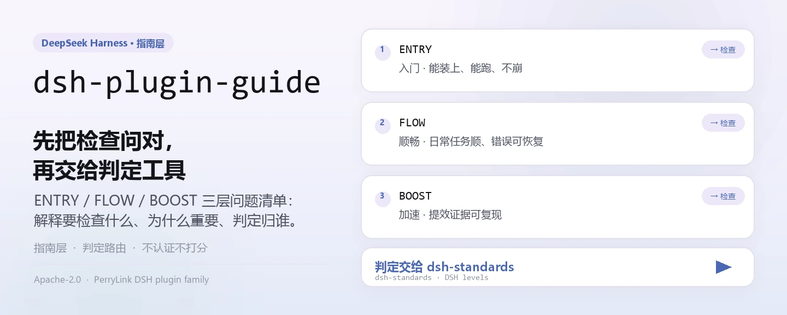
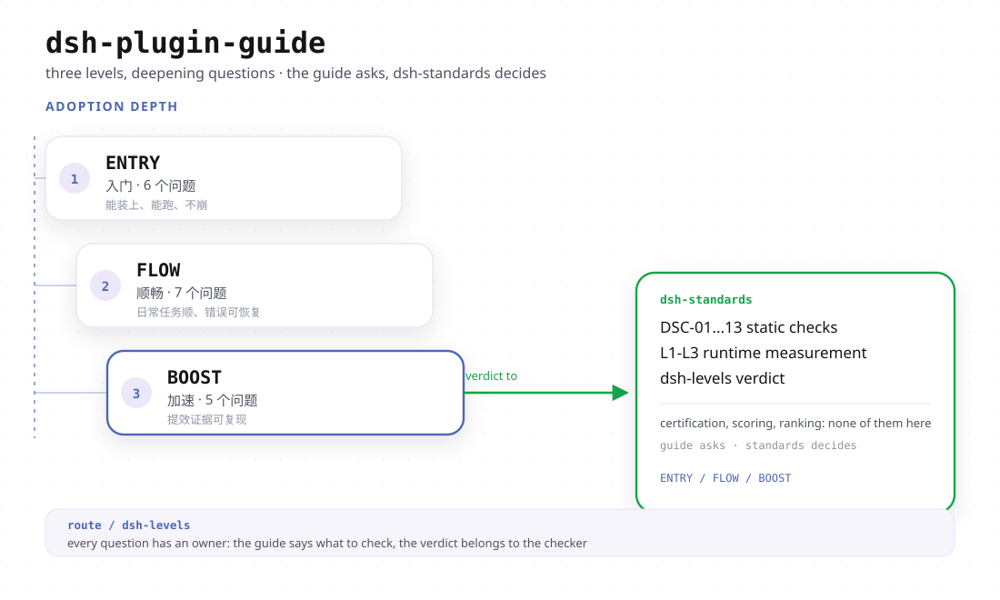

<div align="center">

<picture>
  <source media="(prefers-color-scheme: dark)" srcset="docs/assets/dsh-plugin-guide-hero-zh-dark.webp">
  
</picture>

# dsh-plugin-guide

**先问对问题再动手：把 DSH 插件的 ENTRY / FLOW / BOOST 三层问清楚，判定交给真正做检查的工具。**

DSH 插件的指南层——解释要检查什么、为什么重要、判定归谁；自身不做认证、不打分、不排名，只把检查路由到 `dsh-standards`。

[安装](#三步上手) · [配置](#配置) · [FAQ](#faq) · [简体中文](README.md) · [English](README.en.md) · [Español](README.es.md) · [Português](README.pt.md) · [हिन्दी](README.hi.md)

[](LICENSE)
[](#兼容性)
[](https://www.npmjs.com/package/dsh-plugin-guide)
[](https://github.com/PerryLink/dsh-plugin-guide/actions/workflows/verify.yml)
[](#兼容性)

[](https://github.com/PerryLink/dsh-plugin-guide/stargazers)
[](https://www.npmjs.com/package/dsh-plugin-guide)
[](https://gitee.com/perrylink/dsh-plugin-guide)

```sh
dsh plugin --profile web add dsh-plugin-guide
```

</div>

<sub>社区指南，与 DeepSeek 官方无关；不是认证、不是排名、不是安全审计。唯一仓库：<https://github.com/PerryLink/dsh-plugin-guide>（Gitee 为只读快照）。</sub>

## 它是什么

`dsh-plugin-guide` 是 DSH 插件的**指南层**：它解释要检查什么、为什么重要，以及判定应该由哪个工具负责。安装后它向宿主注册一个按需加载的 agent 技能，技能正文就是 `SKILL.md`，其中的相对引用（`./docs/...`）通过 `resourceBase` 目录解析到本包。它不做认证、不打分、不排名——检查在 `dsh-standards`，规则文本在 `dsh-plugin-spec`，构建与脚手架在 `dsh-primer`。

| 包 | 角色 |
|---|---|
| **`dsh-plugin-guide`** | 本包：文字指南、三层地图、agent 技能 |
| **`dsh-standards`** | 执行总包：ENTRY/FLOW 检查、三层审计（`dsh-levels`）、规范文件 |
| **`dsh-plugin-spec`** | 底层规则文本与条款来源 |
| **`dsh-primer`** | 旧的构建/脚手架技能和 CLI（原 `dsh-plugin-guide` 0.3.x） |

### 上游与使用（事实，2026-11）

- **dsh-plugin-hub** —— 版本感知的 npm 元数据校验已合入 main（[`4f3a560`](https://github.com/dshplugin/dsh-plugin-hub/commit/4f3a560)，2026-11-09）。范围仅安装侧 npm 元数据；不运行 ENTRY，也不构成对任何插件或市场的背书。
- **使用量**（npm registry，2026-11）：本指南 ≈12.6k/月、`dsh-standards` ≈4.4k/月、`dsh-plugin-start` ≈1.65k/月。下载量不是独立用户数，也不构成排名、认证或安全结论。
- **作者侧入口**：`dsh-plugin-start`（生成器，产物自带检查与 advisory CI）、`dsh-check-action`（只读 ENTRY Action）。

<picture>
  <source media="(prefers-color-scheme: dark)" srcset="docs/assets/dsh-plugin-guide-flow-v4-dark.svg">
  
</picture>

## 三步上手

1. **安装**（三选一）：

   ```sh
   # git 通道（最新 main）
   dsh plugin --profile web add github:PerryLink/dsh-plugin-guide
   # npm 通道（已发布版本）
   dsh plugin --profile web add dsh-plugin-guide
   # tarball 通道：本仓库 npm pack 后
   dsh plugin --profile web add ./dsh-plugin-guide-<version>.tgz
   ```

   无构建步骤：`index.js` 即发布产物，`SKILL.md` 与 `docs/` 就是技能正文。

2. **让 agent 用一次技能**（技能按需加载，不常驻上下文）：

   ```text
   > 用 dsh-plugin-guide 审一下 ./my-plugin：先给 ENTRY 结论，再说明哪些层是 not-run。
   ```

3. **验证已生效**：

   ```sh
   dsh --profile web --dump-config | grep -A2 'id: dsh-plugin-guide'
   ```

   会话技能目录里应出现 `dsh-plugin-guide`，且技能正文指向 `docs/levels.md`（`package.json#dshWorkshop.capability.expected` 记录的验收形态）。

**卸载**：`dsh plugin --profile web remove dsh-plugin-guide`（或从 profile patch 删掉该行）。注册是 Cordis effect，卸载即撤销，不留残留。

## 核心能力

- **三层地图** —— ENTRY 问「能不能被识别、安装、启动」，FLOW 问「用户能不能装、配、用、升级、卸载」，BOOST 问「有没有用好 Cordis」。三条轨道，不是三个等级；它们相加不等于分数或证书。
- **检查路由** —— 本包只解释与分流：一致性检查交给 `dsh-standards`，规则文本查 `dsh-plugin-spec`，要搭新插件去找 `dsh-primer`（旧的 `dsh-plugin-dev` CLI 已在那边，不在本包）。
- **证据规则** —— `static` ≠ `runtime`、`recognized` ≠ `pass`、`not-run` ≠ `pass`；一条 PASS 需要命令、产物、环境与日期，缺了就写 `not-run` / `not-measured` / `incomplete`。
- **按需技能** —— `index.js` 读取 `SKILL.md`、剥掉 YAML frontmatter，以 `source: bundled` 与目录型 `resourceBase` 注册；技能只在被问到时进场，不占常驻提示前缀。
- **不越权** —— 不给判定、不挂市场门禁、不冒充官方；措辞纪律写在 `SKILL.md` 与 `STANDARDS.md` 里，可逐条核对。

### 三层分工

| 层 | 回答 | 能否判定 |
|---|---|---|
| **ENTRY** | 能不能被识别、安装、启动 | 能：recognized / runtime / failed / incomplete / unavailable |
| **FLOW** | 用户能不能装、配、用、升级、卸载 | 有 runtime 证据时能；否则 `not-run` |
| **BOOST** | 有没有用好 Cordis | 不给插件级判定；按实践登记证据 |

先读一页地图：[docs/levels.md](docs/levels.md)。发布前自查：[docs/release-checklist.md](docs/release-checklist.md)。

### 检查命令

```sh
# 只做 ENTRY 识别（不声明 runtime）
npx dsh-standards ./my-plugin --scope entry --entry-claim static

# 三层审计；没跑的层保持 not-run / not-measured
npx -p dsh-standards dsh-levels ./my-plugin --format json
```

`recognized` 不是通过，`static` 不是通过，`not-run` 也不是通过。退出码：`0` 完成、`1` 可归因 FAIL、`2` 未完成/not-run、`3` 用法错误——`not-run` 与 `incomplete` 不得写成 pass（见 [docs/entry.md](docs/entry.md)）。

### 0.4.0 改了什么

- 旧的 agent 技能和 `dsh-plugin-dev` CLI 已迁到 [`dsh-primer`](https://github.com/PerryLink/dsh-primer)。
- 本包现在是**指南层**：三层地图、检查路由、证据规则。
- 旧 0.3.x npm 版本已标记 deprecated，已有安装仍可用；0.4.0 是产品切换，锁在 `^0.3` 的用户不会自动升级。
- 检查在 [`dsh-standards`](https://github.com/PerryLink/dsh-standards)，不在本包。

## 配置

本包没有 Schemastery `Config`：`cordis.patch.yml` 只 `insert` 一行，插件不读取任何 `config.*` 键。可调整的只有这一行本身和它所在的 profile。

| 键 | 默认值 | 含义 |
|---|---|---|
| `id` | `dsh-plugin-guide` | 行标识；后续 patch 层按 `id` 覆盖该行（整行替换） |
| `name` | `dsh-plugin-guide` | loader 要 import 的模块（`package.json#main` → `index.js`） |
| `config` | 不接受 | 本包不读任何配置键；写在这里不会生效 |

<details>
<summary>完整补丁文件（cordis.patch.yml，9 行）</summary>

```yaml
# dsh-plugin-guide bundle layer: register the packaged knowledge base as an agent skill.
# This file is the `dsh.bundle.patch` layer (see package.json#dsh.bundle.patch).
# Layer semantics: a YAML array of row verbs; `insert` adds plugin rows to the
# composed config. Later layers override a row by `id` (whole-config replacement).
- insert:
    # `id`: stable row identifier used by later layers to override this row.
    - id: dsh-plugin-guide
      # `name`: the module the loader imports; resolves to this package's entry (package.json#main → index.js).
      name: dsh-plugin-guide
```

</details>

要停用：从 profile patch 删掉该行，或执行 `dsh plugin --profile web remove dsh-plugin-guide`。

## FAQ

<details>
<summary>它会替我判定一个插件合不合格吗？</summary>

不会。本包是指南层，不是判定层：它解释三层问题、把检查路由到 `dsh-standards`，并给出证据规则。BOOST 更没有插件级的 pass/fail——实践可以登记证据，插件不会被贴「BOOST 等级」。

</details>

<details>
<summary>`recognized` 或 `static` 的结果算通过吗？</summary>

不算。`recognized` 只说明包形态可被识别，`static` 只说明做过静态预检；`static` ≠ `runtime`，`not-run` ≠ `pass`。FLOW 只跑了几个 journey 时结论是 `not-run`，不是软通过——也不要把 FLOW 的通过率或等级写进 README。

</details>

<details>
<summary>装上它会改动我的 profile 或别的插件吗？</summary>

不会。它只向 `skills` 服务注册一个技能（名字 `dsh-plugin-guide`，`source: bundled`），注册包在 `ctx.effect()` 里，卸载或热重载即撤销；不注册工具、命令、客户端 slot 或 `webServer` 前缀，不发网络请求，权限只声明 `filesystem:read`。

</details>

<details>
<summary>0.3.x 的老用户怎么办？</summary>

0.3.x 已标记 deprecated，但仍可安装；0.4.0 是产品切换，锁在 `^0.3` 的 profile 不会自动升级。旧的构建/脚手架技能与 `dsh-plugin-dev` CLI 现在归 [`dsh-primer`](https://github.com/PerryLink/dsh-primer)，本包只保留指南与路由。

</details>

<details>
<summary>检查器和规则原文在哪？</summary>

检查器与三层审计在 [`dsh-standards`](https://www.npmjs.com/package/dsh-standards)（`npx dsh-standards`、`npx -p dsh-standards dsh-levels`），规则文本在 [`dsh-plugin-spec`](https://github.com/PerryLink/dsh-plugin-spec)。本包 `package.json` 里的 `dsh.standards` 占位仍是 entry/flow = `not-run`、boost = `not-measured`、`evidence: null`——那是「没测」，不是「通过」。

</details>

## 安全边界

- 不做官方背书、认证、认可或安全审计。
- 不做评分、排名或市场门禁。
- 不伪造 runtime 证据：`static` ≠ `runtime`，`not-run` ≠ `pass`。
- BOOST 是建议和证据，不是插件等级。
- **文本即边界。** 指南只写能指向源文档的陈述；无法测量的实践（开发工时、维护成本）记成 WARN 或备注，不编数字（见 [docs/boost.md](docs/boost.md)）。
- **本包非官方。** 没有认证、认可、安全审计、排名或市场门禁；对外措辞里不出现 official / certified / secure / recommended / ranked 一类声明（见 [STANDARDS.md](STANDARDS.md)）。

## 权限与数据

- **权限**：`package.json#dshWorkshop.permissions` 只声明 `filesystem:read`。插件在 `apply()` 时读取包内 `SKILL.md`，技能正文的相对引用通过目录型 `resourceBase` 解析到包内 `docs/`。
- **数据**：不写 workspace、不写 profile 之外的位置；不装遥测、分析、广告或托管账号，也不向 PerryLink 发送任何数据（见 [PRIVACY.md](PRIVACY.md)）。宿主自己的会话/日志存储由宿主控制其保留策略。
- **卸载**：移除包只删代码，不删宿主日志、workspace 文件或你已经产出的文档。

## 已知限制

- **指南不产生判定。** 本包没有 judge 能力：既不能把插件标成 pass，也不能把它标成 fail；判定只来自 `dsh-standards` 实际跑出的结果。
- **FLOW 运行时仍是草案。** J1/J2/J4/J6 在 fixture 上有 runtime 证据；J3/J7 只到 fixture 级 runtime；J5/J8 只有静态预检；浏览器渲染尚未覆盖——所以「只跑了几个 journey」必须写成 `not-run`（见 [docs/flow.md](docs/flow.md)）。
- **BOOST 的实测样例是 fixture / 合成采集，另有一条真实 provider 复测。** 都不是生产基线；LEV-3、LEV-6、LEV-7 证据最强，其中 LEV-6 于 2026-11-07 在真实 DeepSeek API 上复测前缀缓存（90.7% vs 0%，构造臂、单包/单模型/单宿主），其余只有 loader/context 级 fixture；没有证据就是 `not-measured`（见 [docs/boost.md](docs/boost.md)）。
- **规则随宿主演进。** 基线是 2026-11-04 的 DSH `0.2.2-alpha.3` / Cordis `4.0.6-alpha.2`；Node 自 `0.2.2-alpha.2` 起要求 `>=24.9.0`；`ctx.menus` 在 `0.2.2-alpha.3` 已移除；`engines.dsh` 自 `0.2.1-alpha.4` 起单独决定版本走廊（见 [docs/levels.md](docs/levels.md)）。
- **`dsh.standards` 占位不是成绩。** `package.json` 里 entry/flow = `not-run`、boost = `not-measured`、`evidence: null`，它只是占位。
- **0.3.x 停在旧形态。** 0.3.x 是 deprecated 的旧产品线；构建/脚手架能力现在在 `dsh-primer`，本包不再提供 CLI。

## 与其他 DSH 插件的互操作性

本插件**不干扰**其他插件：

- **无工具/命令/服务键冲突。** 不注册任何工具、命令或服务键，因此不占用任何裸名，也不存在服务键冲突。
- **无 slot 与 HTTP 路由冲突。** 不注册客户端 slot key，也不注册任何 `webServer` 前缀。
- **唯一依赖是 `skills` 服务。** `export const inject = ['skills']`，由宿主提供；不 import 宿主实现，只消费这个服务。
- **无共享事件监听。** 不监听 `agent/pre-step`、`tools/post-execute` 一类顺序敏感事件，因此不存在瀑布链条被短路的问题。
- **无 patch 层冲突。** 组合包 patch 只 `insert` 自己那一行，从不覆写内置行的 `config`。
- **无全局改写。** 不改原型、不写 `process.env`、不替换全局 fetch dispatcher。
- **注册即 effect。** `ctx.effect(() => ctx.skills.register(...))`，停止或热重载即撤销贡献。

对照基线：DSH `0.2.2-alpha.3` / Cordis `4.0.6-alpha.2`（[docs/levels.md](docs/levels.md) 记录，2026-11-04）。

## 兼容性

| 维度 | 状态 |
|---|---|
| Harness | `engines.dsh` = `>=0.2.2-0 <0.3.0`（自 `0.2.1-alpha.4` 起 `engines.dsh` 单独决定；npm 默认 semver 需要显式 `^0.2.2-alpha.3` 并集臂）。基线 DSH `0.2.2-alpha.3`（npm `alpha`），Cordis `4.0.6-alpha.2`。 |
| Node | `>=24.9.0`（0.2.2 线的要求，自 `0.2.2-alpha.2` 起） |
| 平台 | 任何 DSH 可运行处（纯文本技能；无浏览器半，无原生扩展） |
| 模型 | 不调用模型：技能文本由宿主注入上下文，无额外模型能力要求 |

## 生态与质量

- [npm 包页](https://www.npmjs.com/package/dsh-plugin-guide)（已发布版本，`0.4.3`）
- [Gitee 镜像](https://gitee.com/perrylink/dsh-plugin-guide)（只读快照；以 GitHub 为准）
- [dsh-standards](https://www.npmjs.com/package/dsh-standards)（检查器与三层审计 `dsh-levels`）
- [dsh-plugin-spec](https://github.com/PerryLink/dsh-plugin-spec)（底层规则文本与条款来源）
- [dsh-primer](https://github.com/PerryLink/dsh-primer)（旧的构建/脚手架技能与 CLI）
- 本仓文档：[三层地图](docs/levels.md) · [ENTRY](docs/entry.md) · [FLOW](docs/flow.md) · [BOOST](docs/boost.md)
- 仓库治理：[CHANGELOG](CHANGELOG.md) · [STANDARDS.md](STANDARDS.md) · [CONTRIBUTING](CONTRIBUTING.md)

## 开发

```sh
npm test                                # node --test tests/*.test.mjs
npm run test:pack                       # npm pack --dry-run
python scripts/gen-readme-assets.py     # 重出 docs/assets 的深浅两版 hero SVG（Python + Pillow）
```

无构建步骤：`index.js` 即发布产物。CI 是 [.github/workflows/verify.yml](.github/workflows/verify.yml)（Node 22 与 24 矩阵，跑单测 + `npm pack --dry-run`）。配图由 [scripts/gen-readme-assets.py](scripts/gen-readme-assets.py) 程序化生成，可重复执行、幂等覆盖。

| 路径 | 作用 |
|---|---|
| `index.js` | 唯一宿主面：读 `SKILL.md`、剥 frontmatter、以 `ctx.effect` 注册技能 |
| `SKILL.md` | 技能正文与 `description`（YAML frontmatter） |
| `docs/` | 三层地图与 ENTRY/FLOW/BOOST 指南，即技能正文的相对引用 |
| `locale/` | 技能的 zh/en 展示元数据（`meta.title`、`meta.description`） |
| `cordis.patch.yml` | bundle 补丁层，只 `insert` 自己一行 |
| `tests/` | `node --test`：技能 frontmatter 解析与注册 |
| `scripts/gen-readme-assets.py` | 程序化出图（Python + Pillow） |
| `STANDARDS.md` · `NOTICE.md` · `PRIVACY.md` | 标准状态、NOTICE、隐私声明 |

## 家族与致谢

本项目是 [PerryLink](https://github.com/PerryLink) 维护的 DeepSeek Harness 插件家族成员（全部 Apache-2.0）。如果这份指南帮到了你，**给个 star**——它不解锁任何功能，但会让下一个人更容易找到它。

- [@PerryLink](https://github.com/PerryLink) —— 创建者与维护者：三层地图与 ENTRY/FLOW/BOOST 指南文本、`SKILL.md` 技能、bundle 补丁层与五语文档。

<details>
<summary>展开全部插件</summary>

| 插件 | 状态 |
|---|---|
| **[dsh-aqua-input-check](https://github.com/PerryLink/dsh-aqua-input-check)** |  |
| **[dsh-archive-check](https://github.com/PerryLink/dsh-archive-check)** |  |
| **[dsh-auto-review](https://github.com/PerryLink/dsh-auto-review)** |  |
| **[dsh-autotier](https://github.com/PerryLink/dsh-autotier)** | 🧊 已冻结 — 见仓库 README |
| **[dsh-bid-ca-precheck](https://github.com/PerryLink/dsh-bid-ca-precheck)** |  |
| **[dsh-bid-qual-check](https://github.com/PerryLink/dsh-bid-qual-check)** |  |
| **[dsh-cert-mcp](https://github.com/PerryLink/dsh-cert-mcp)** | 🧊 已冻结 — 见仓库 README |
| **[dsh-checkpoint-rewind](https://github.com/PerryLink/dsh-checkpoint-rewind)** |  |
| **[dsh-click](https://github.com/PerryLink/dsh-click)** |  |
| **[dsh-composer-history](https://github.com/PerryLink/dsh-composer-history)** |  |
| **[dsh-contract-stance](https://github.com/PerryLink/dsh-contract-stance)** |  |
| **[dsh-customs-doc-check](https://github.com/PerryLink/dsh-customs-doc-check)** |  |
| **[dsh-data-quality](https://github.com/PerryLink/dsh-data-quality)** | 🧊 已冻结 — 见仓库 README |
| **[dsh-demurrage-ledger](https://github.com/PerryLink/dsh-demurrage-ledger)** |  |
| **[dsh-doublecheck](https://github.com/PerryLink/dsh-doublecheck)** |  |
| **[dsh-drill-script-check](https://github.com/PerryLink/dsh-drill-script-check)** |  |
| **[dsh-eia-guide-check](https://github.com/PerryLink/dsh-eia-guide-check)** |  |
| **[dsh-emergency-plan](https://github.com/PerryLink/dsh-emergency-plan)** |  |
| **[dsh-essay-rubric-check](https://github.com/PerryLink/dsh-essay-rubric-check)** |  |
| **[dsh-evidence-check](https://github.com/PerryLink/dsh-evidence-check)** |  |
| **[dsh-export-ctl-check](https://github.com/PerryLink/dsh-export-ctl-check)** |  |
| **[dsh-fast](https://github.com/PerryLink/dsh-fast)** |  |
| **[dsh-fmea-table-check](https://github.com/PerryLink/dsh-fmea-table-check)** |  |
| **[dsh-forecast-penalty](https://github.com/PerryLink/dsh-forecast-penalty)** |  |
| **[dsh-fund-research](https://github.com/PerryLink/dsh-fund-research)** |  |
| **[dsh-github](https://github.com/PerryLink/dsh-github)** |  |
| **[dsh-gongwen-flow-check](https://github.com/PerryLink/dsh-gongwen-flow-check)** |  |
| **[dsh-gongwen-word-check](https://github.com/PerryLink/dsh-gongwen-word-check)** |  |
| **[dsh-guard-plan-qc](https://github.com/PerryLink/dsh-guard-plan-qc)** |  |
| **[dsh-hazchem-check](https://github.com/PerryLink/dsh-hazchem-check)** |  |
| **[dsh-hazplan-check](https://github.com/PerryLink/dsh-hazplan-check)** |  |
| **[dsh-hidden-risk-map](https://github.com/PerryLink/dsh-hidden-risk-map)** |  |
| **[dsh-hs-classify](https://github.com/PerryLink/dsh-hs-classify)** |  |
| **[dsh-icd-rule-check](https://github.com/PerryLink/dsh-icd-rule-check)** |  |
| **[dsh-industry-research](https://github.com/PerryLink/dsh-industry-research)** |  |
| **[dsh-lawcite-adapter](https://github.com/PerryLink/dsh-lawcite-adapter)** |  |
| **[dsh-laya](https://github.com/PerryLink/dsh-laya)** |  |
| **[dsh-lc-doc-check](https://github.com/PerryLink/dsh-lc-doc-check)** |  |
| **[dsh-learning-gap-check](https://github.com/PerryLink/dsh-learning-gap-check)** |  |
| **[dsh-library](https://github.com/PerryLink/dsh-library)** |  |
| **[dsh-local-ai](https://github.com/PerryLink/dsh-local-ai)** |  |
| **[dsh-lsp-actions](https://github.com/PerryLink/dsh-lsp-actions)** |  |
| **[dsh-mask](https://github.com/PerryLink/dsh-mask)** |  |
| **[dsh-mcp-panel](https://github.com/PerryLink/dsh-mcp-panel)** |  |
| **[dsh-medrec-qc](https://github.com/PerryLink/dsh-medrec-qc)** |  |
| **[dsh-memento](https://github.com/PerryLink/dsh-memento)** | 🧊 已冻结 — 见仓库 README |
| **[dsh-nsfc-form-check](https://github.com/PerryLink/dsh-nsfc-form-check)** |  |
| **[dsh-nurse-record-check](https://github.com/PerryLink/dsh-nurse-record-check)** |  |
| **[dsh-observe](https://github.com/PerryLink/dsh-observe)** |  |
| **[dsh-origin-rvc-check](https://github.com/PerryLink/dsh-origin-rvc-check)** |  |
| **[dsh-ota-review-check](https://github.com/PerryLink/dsh-ota-review-check)** |  |
| **[dsh-output-styles](https://github.com/PerryLink/dsh-output-styles)** |  |
| **[dsh-paper-doc-adapter](https://github.com/PerryLink/dsh-paper-doc-adapter)** |  |
| **[dsh-permission-rules](https://github.com/PerryLink/dsh-permission-rules)** |  |
| **[dsh-permit-report-check](https://github.com/PerryLink/dsh-permit-report-check)** |  |
| **[dsh-pipeline-check](https://github.com/PerryLink/dsh-pipeline-check)** |  |
| **[dsh-pleading-draft](https://github.com/PerryLink/dsh-pleading-draft)** |  |
| **[dsh-plugin-doctor](https://github.com/PerryLink/dsh-plugin-doctor)** | 🚫 已退役（仓库已归档） |
| **[dsh-plugin-guide](https://github.com/PerryLink/dsh-plugin-guide)** |  |
| **[dsh-plugin-kit](https://github.com/PerryLink/dsh-plugin-kit)** | 🚫 已退役（仓库已归档） |
| **[dsh-plugin-upgrade](https://github.com/PerryLink/dsh-plugin-upgrade)** | 🚫 已退役（仓库已归档） |
| **[dsh-policy-brief-draft](https://github.com/PerryLink/dsh-policy-brief-draft)** |  |
| **[dsh-power-loss-split](https://github.com/PerryLink/dsh-power-loss-split)** |  |
| **[dsh-power-ticket-check](https://github.com/PerryLink/dsh-power-ticket-check)** |  |
| **[dsh-ppap-check](https://github.com/PerryLink/dsh-ppap-check)** |  |
| **[dsh-protest-deadline](https://github.com/PerryLink/dsh-protest-deadline)** |  |
| **[dsh-railway-window](https://github.com/PerryLink/dsh-railway-window)** |  |
| **[dsh-repair-order-qc](https://github.com/PerryLink/dsh-repair-order-qc)** |  |
| **[dsh-research-report](https://github.com/PerryLink/dsh-research-report)** |  |
| **[dsh-review-reply-check](https://github.com/PerryLink/dsh-review-reply-check)** |  |
| **[dsh-rulefile-check](https://github.com/PerryLink/dsh-rulefile-check)** |  |
| **[dsh-safety-brief-check](https://github.com/PerryLink/dsh-safety-brief-check)** |  |
| **[dsh-score](https://github.com/PerryLink/dsh-score)** | 🧊 已冻结 — 见仓库 README |
| **[dsh-session-sync](https://github.com/PerryLink/dsh-session-sync)** |  |
| **[dsh-site-log-check](https://github.com/PerryLink/dsh-site-log-check)** |  |
| **[dsh-skill-pack-security](https://github.com/PerryLink/dsh-skill-pack-security)** |  |
| **[dsh-soe-decision-check](https://github.com/PerryLink/dsh-soe-decision-check)** |  |
| **[dsh-soilwater-check](https://github.com/PerryLink/dsh-soilwater-check)** |  |
| **[dsh-sop-sync-check](https://github.com/PerryLink/dsh-sop-sync-check)** |  |
| **[dsh-spc-gbt-adapter](https://github.com/PerryLink/dsh-spc-gbt-adapter)** |  |
| **[dsh-talk](https://github.com/PerryLink/dsh-talk)** |  |
| **[dsh-tender-extract](https://github.com/PerryLink/dsh-tender-extract)** |  |
| **[dsh-tender-matrix](https://github.com/PerryLink/dsh-tender-matrix)** |  |
| **[dsh-test-drive](https://github.com/PerryLink/dsh-test-drive)** |  |
| **[dsh-ticktick](https://github.com/PerryLink/dsh-ticktick)** | 🚫 已退役（仓库已归档） |
| **[dsh-translate](https://github.com/PerryLink/dsh-translate)** |  |
| **[dsh-warranty-calc](https://github.com/PerryLink/dsh-warranty-calc)** |  |
| **[dsh-budget](https://github.com/PerryLink/dsh-budget)** | 🧊 已冻结 — 见仓库 README |
| **[dsh-claude-move](https://github.com/PerryLink/dsh-claude-move)** | 🧊 已冻结 — 见仓库 README |
| **[dsh-defend](https://github.com/PerryLink/dsh-defend)** | 🧊 已冻结 — 见仓库 README |
| **[dsh-draw](https://github.com/PerryLink/dsh-draw)** | 🧊 已冻结 — 见仓库 README |
| **[dsh-reach](https://github.com/PerryLink/dsh-reach)** | 🧊 已冻结 — 见仓库 README |
| **[dsh-background-agents](https://github.com/PerryLink/dsh-background-agents)** | 🚫 已退役（仓库已归档） |
| **[dsh-session-pin](https://github.com/PerryLink/dsh-session-pin)** | 🚫 已退役（仓库已归档） |
| **[dsh-team-rooms](https://github.com/PerryLink/dsh-team-rooms)** | 🚫 已退役（仓库已归档） |

</details>

## License

[LICENSE](LICENSE)（Apache License 2.0）© 2026 dsh-plugin-guide contributors

<p align="center"><sub>Apache-2.0 · 社区指南，与 DeepSeek 无关。</sub></p>
