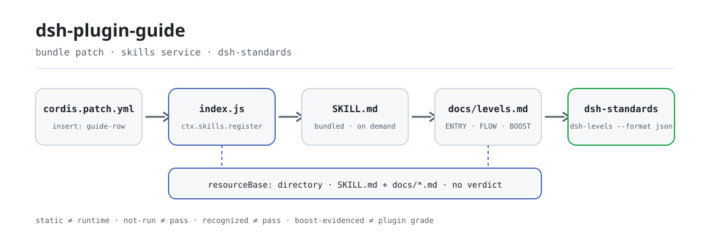

<div align="center">

<picture>
  <source media="(prefers-color-scheme: dark)" srcset="docs/assets/dsh-plugin-guide-flow-dark.svg">
  
</picture>

# dsh-plugin-guide

**Faça a pergunta certa antes de construir: esclareça as camadas ENTRY / FLOW / BOOST de um plugin DSH e deixe o veredito para a ferramenta que executa as verificações.**

A camada de guia para plugins DSH: explica o que verificar, por que importa e qual ferramenta é dona do veredito; não certifica, não pontua e não classifica, apenas encaminha as verificações para o `dsh-standards`.

[Instalar](#instalação-em-três-passos) · [Configuração](#configuração) · [FAQ](#faq) · [简体中文](README.md) · [English](README.en.md) · [Español](README.es.md) · [Português](README.pt.md) · [हिन्दी](README.hi.md)

[](LICENSE)
[](#compatibilidade)
[](https://www.npmjs.com/package/dsh-plugin-guide)
[](https://github.com/PerryLink/dsh-plugin-guide/actions/workflows/verify.yml)
[](#compatibilidade)

[](https://github.com/PerryLink/dsh-plugin-guide/stargazers)
[](https://www.npmjs.com/package/dsh-plugin-guide)
[](https://gitee.com/perrylink/dsh-plugin-guide)

```sh
dsh plugin --profile web add dsh-plugin-guide
```

</div>

<sub>Guia da comunidade, sem vínculo com a DeepSeek; não é certificação, nem ranking, nem auditoria de segurança. Repositório canônico: <https://github.com/PerryLink/dsh-plugin-guide> (o Gitee é um snapshot somente leitura).</sub>

## O que é

`dsh-plugin-guide` é a **camada de guia** para plugins DSH: explica o que verificar, por que importa e qual ferramenta é dona do veredito. Ao ser instalado, registra uma skill de agente carregada sob demanda cujo corpo é o `SKILL.md`; as referências relativas desse corpo (`./docs/...`) resolvem dentro do pacote por meio de um `resourceBase` de diretório. Não certifica, não pontua e não classifica: as verificações ficam no `dsh-standards`, o texto das regras no `dsh-plugin-spec` e a construção/andaime no `dsh-primer`.

| Pacote | Papel |
|---|---|
| **`dsh-plugin-guide`** | Este pacote: a guia em prosa, o mapa de três camadas e a skill de agente |
| **`dsh-standards`** | O guarda-chuva de execução: verificações ENTRY/FLOW, auditoria `dsh-levels` e os arquivos de especificação |
| **`dsh-plugin-spec`** | O texto de regras de baixo nível e a fonte das cláusulas |
| **`dsh-primer`** | A skill e CLI legadas de construção/andaime (antigo `dsh-plugin-guide` 0.3.x) |

## Instalação em três passos

1. **Instalar** (escolha um canal):

   ```sh
   # canal git (main mais recente)
   dsh plugin --profile web add github:PerryLink/dsh-plugin-guide
   # canal npm (versões publicadas)
   dsh plugin --profile web add dsh-plugin-guide
   # canal tarball: após npm pack neste repositório
   dsh plugin --profile web add ./dsh-plugin-guide-<version>.tgz
   ```

   Sem etapa de build: `index.js` é o artefato publicado, e `SKILL.md` mais `docs/` são o corpo da skill.

2. **Pedir a skill uma vez** (as skills carregam sob demanda, nunca como prompt residente):

   ```text
   > Use dsh-plugin-guide para revisar ./my-plugin: primeiro o veredito ENTRY e depois quais camadas estão not-run.
   ```

3. **Verificar que entrou em vigor**:

   ```sh
   dsh --profile web --dump-config | grep -A2 'id: dsh-plugin-guide'
   ```

   O catálogo de skills da sessão deve listar `dsh-plugin-guide`, e o corpo carregado deve apontar para `docs/levels.md` (a forma de aceitação registrada em `package.json#dshWorkshop.capability.expected`).

**Desinstalar**: `dsh plugin --profile web remove dsh-plugin-guide` (ou apague a linha do patch do perfil). O registro é um efeito do Cordis, então descarregar o plugin o remove sem deixar resíduo.

## Capacidades principais

- **Mapa de três camadas** — ENTRY pergunta «dá para reconhecer, instalar e iniciar?», FLOW pergunta «o usuário consegue instalar, configurar, usar, atualizar e remover?» e BOOST pergunta «usa o Cordis bem?». Três trilhas, não três notas; juntas não somam pontuação nem certificado.
- **Roteamento de verificações** — este pacote apenas explica e encaminha: verificações de conformidade vão para o `dsh-standards`, o texto de regras está no `dsh-plugin-spec` e construir um plugin é trabalho do `dsh-primer` (a antiga CLI `dsh-plugin-dev` vive lá, não aqui).
- **Regras de evidência** — `static` ≠ `runtime`, `recognized` ≠ `pass`, `not-run` ≠ `pass`; um PASS exige comando, artefato, ambiente e data; se faltar algo, escreva `not-run`, `not-measured` ou `incomplete`.
- **Skill sob demanda** — `index.js` lê o `SKILL.md`, remove o frontmatter YAML e o registra com `source: bundled` e um `resourceBase` de diretório; a skill entra no contexto só quando solicitada, sem prefixo residente.
- **Sem autoridade emprestada** — sem vereditos, sem portão de mercado e sem alegação de oficialidade; a disciplina de redação está escrita no `SKILL.md` e no `STANDARDS.md` e pode ser conferida linha a linha.

### As três camadas

| Camada | Pergunta | Pode emitir veredito? |
|---|---|---|
| **ENTRY** | Dá para reconhecer, instalar e iniciar? | Sim: recognized / runtime / failed / incomplete / unavailable |
| **FLOW** | O usuário consegue instalar, configurar, usar, atualizar e remover? | Sim, apenas onde há evidência de runtime; caso contrário, `not-run` |
| **BOOST** | Usa o Cordis bem? | Sem veredito no nível do plugin; a evidência é registrada por prática |

Leia primeiro o mapa de uma página: [docs/levels.md](docs/levels.md).

### Executar as verificações

```sh
# Apenas reconhecimento ENTRY (sem reivindicar runtime)
npx dsh-standards ./my-plugin --scope entry --entry-claim static

# Auditoria de três camadas; camadas não executadas continuam not-run / not-measured
npx -p dsh-standards dsh-levels ./my-plugin --format json
```

`recognized` não é aprovação, `static` não é aprovação e `not-run` também não. Códigos de saída: `0` concluído, `1` FAIL atribuível, `2` incompleto/not-run, `3` erro de uso; um resultado `not-run` ou `incomplete` nunca deve ser escrito como aprovação (veja [docs/entry.md](docs/entry.md)).

### O que mudou em 0.4.0

- A skill de agente anterior e a CLI `dsh-plugin-dev` mudaram para o [`dsh-primer`](https://github.com/PerryLink/dsh-primer).
- Este pacote agora é a camada de **guia**: mapa de três camadas, roteamento de verificações e regras de evidência.
- As versões 0.3.x no npm estão obsoletas e continuam disponíveis para instalações existentes. A linha 0.4.0 é uma mudança de produto; quem está fixado em `^0.3` não atualiza sozinho.
- As verificações vivem no [`dsh-standards`](https://github.com/PerryLink/dsh-standards), não neste pacote.

## Configuração

Este pacote não tem `Config` de Schemastery: o `cordis.patch.yml` apenas `insert`a uma linha e o plugin não lê nenhuma chave `config.*`. O único ajustável são essa linha e o perfil onde ela vive.

| Chave | Padrão | Significado |
|---|---|---|
| `id` | `dsh-plugin-guide` | Identificador da linha; uma camada de patch posterior a substitui por `id` (substituição da linha inteira) |
| `name` | `dsh-plugin-guide` | O módulo que o loader importa (`package.json#main` → `index.js`) |
| `config` | não aceito | Este pacote não lê chaves de configuração; o que for escrito aqui não tem efeito |

<details>
<summary>Arquivo de patch completo (cordis.patch.yml, 9 linhas)</summary>

```yaml
# dsh-plugin-guide bundle layer: register the packaged knowledge base as an agent skill.
# This file is the `dsh.bundle.patch` layer (see package.json#dsh.bundle.patch).
# Layer semantics: a YAML array of row verbs; `insert` adds plugin rows to the
# composed config. Later layers override a row by `id` (whole-config replacement).
- insert:
    # `id`: stable row identifier used by later layers to override this row.
    - id: dsh-plugin-guide
      # `name`: the module the loader imports; resolves to this package's entry (package.json#main → index.js).
      name: dsh-plugin-guide
```

</details>

Para desativar: apague essa linha do patch do perfil ou rode `dsh plugin --profile web remove dsh-plugin-guide`.

## FAQ

<details>
<summary>Ele vai decidir se meu plugin é bom o suficiente?</summary>

Não. Este pacote é a camada de guia, não o juiz: explica as três camadas, encaminha as verificações para o `dsh-standards` e enuncia as regras de evidência. O BOOST também não tem aprovado/reprovado no nível do plugin: uma prática pode carregar evidência, mas um plugin nunca recebe um «nível BOOST».

</details>

<details>
<summary>Um resultado `recognized` ou `static` conta como aprovação?</summary>

Não. `recognized` só significa que a forma do pacote pode ser identificada e `static` só que houve pré-verificação estática; `static` ≠ `runtime` e `not-run` ≠ `pass`. Quando o FLOW percorreu apenas alguns journeys o status é `not-run`, nunca aprovação branda; também não se deve publicar taxa de aprovação nem nota de FLOW.

</details>

<details>
<summary>Instalá-lo mexe no meu perfil ou nos outros plugins?</summary>

Não. Ele registra exatamente uma skill no serviço `skills` (nome `dsh-plugin-guide`, `source: bundled`), envolta em `ctx.effect()` para que descarregar ou recarregar a quente a remova; não registra ferramentas, comandos, slots de cliente nem prefixo `webServer`, não faz requisições de rede e declara apenas a permissão `filesystem:read`.

</details>

<details>
<summary>E os usuários de 0.3.x?</summary>

0.3.x está obsoleto mas ainda pode ser instalado; 0.4.0 é uma troca de produto, então um perfil fixado em `^0.3` não atualiza sozinho. A skill e a CLI legadas de construção/andaime agora pertencem ao [`dsh-primer`](https://github.com/PerryLink/dsh-primer); este pacote mantém apenas a guia e o roteamento.

</details>

<details>
<summary>Onde ficam de fato o verificador e o texto das regras?</summary>

O verificador e a auditoria de três camadas ficam no [`dsh-standards`](https://www.npmjs.com/package/dsh-standards) (`npx dsh-standards`, `npx -p dsh-standards dsh-levels`); o texto das regras fica no [`dsh-plugin-spec`](https://github.com/PerryLink/dsh-plugin-spec). O marcador `dsh.standards` no `package.json` deste pacote continua em entry/flow = `not-run`, boost = `not-measured`, `evidence: null`: isso significa «não medido», não «aprovado».

</details>

## Limites de segurança

- Sem aval oficial, certificação, acreditação ou auditoria de segurança.
- Sem pontuação, ranking ou portão de mercado.
- Sem evidência de runtime inventada: `static` ≠ `runtime`, `not-run` ≠ `pass`.
- BOOST é conselho e evidência, nunca nota do plugin.
- **O texto é o limite.** A guia só afirma o que pode apontar em um documento fonte; uma prática que não pode ser medida (horas de desenvolvimento, custo de manutenção) é registrada como WARN ou nota, nunca como número inventado (veja [docs/boost.md](docs/boost.md)).
- **Não oficial por construção.** Sem certificação, acreditação, auditoria de segurança, ranking ou portão de mercado; a redação evita alegações official / certified / secure / recommended / ranked (veja [STANDARDS.md](STANDARDS.md)).

## Permissões e dados

- **Permissões**: `package.json#dshWorkshop.permissions` declara apenas `filesystem:read`. No `apply()` o plugin lê o `SKILL.md` empacotado, e as referências relativas do corpo resolvem no `docs/` do pacote por meio do `resourceBase` de diretório.
- **Dados**: nada é escrito no workspace nem fora do perfil; não há telemetria, analytics, publicidade ou conta hospedada, e nenhum dado é enviado à PerryLink (veja [PRIVACY.md](PRIVACY.md)). O armazenamento de sessões e logs do host e sua retenção são controlados pelo host.
- **Desinstalação**: remover o pacote apaga apenas o código, não os logs do host, os arquivos do workspace nem os documentos que você já produziu.

## Limitações conhecidas

- **A guia não produz veredito.** Não tem capacidade de juiz: não pode marcar um plugin como aprovado nem como reprovado; o veredito só vem de um resultado que o `dsh-standards` realmente executou.
- **O runtime do FLOW ainda é um rascunho.** J1/J2/J4/J6 têm evidência de runtime em fixtures; J3/J7 chegam apenas a runtime de nível fixture; J5/J8 têm só pré-verificação estática; a renderização no navegador ainda não é coberta; por isso «apenas alguns journeys rodaram» deve ser escrito como `not-run` (veja [docs/flow.md](docs/flow.md)).
- **Os exemplos medidos do BOOST são fixtures ou capturas sintéticas.** Não são linhas de base de produção; LEV-3, LEV-6 e LEV-7 têm a evidência mais forte, os demais apenas fixtures de nível loader/contexto; sem evidência o status é `not-measured` (veja [docs/boost.md](docs/boost.md)).
- **As regras acompanham o host.** A linha de base é DSH `0.2.2-alpha.3` / Cordis `4.0.6-alpha.2` em 2026-11-04; o Node exige `>=24.9.0` desde `0.2.2-alpha.2`; `ctx.menus` sumiu em `0.2.2-alpha.3`; e desde `0.2.1-alpha.4` o `engines.dsh` declarado decide sozinho o corredor de versões (veja [docs/levels.md](docs/levels.md)).
- **O marcador `dsh.standards` não é nota.** No `package.json`, entry/flow = `not-run`, boost = `not-measured`, `evidence: null`: apenas um marcador.
- **0.3.x fica na forma antiga.** 0.3.x é uma linha obsoleta; a capacidade de construção/andaime agora está no `dsh-primer` e este pacote não inclui CLI.

## Interoperabilidade com outros plugins DSH

Este plugin **não interfere** em outros plugins:

- **Sem colisão de ferramentas, comandos ou chaves de serviço.** Não registra ferramentas, comandos nem chaves de serviço, então não ocupa nomes nus e não pode colidir em chave de serviço.
- **Sem colisão de slots nem de rotas HTTP.** Não registra chaves de slot de cliente nem prefixo `webServer`.
- **A única dependência é o serviço `skills`.** `export const inject = ['skills']`, fornecido pelo host; não importa a implementação do host, apenas consome esse serviço.
- **Sem listeners de eventos compartilhados.** Não escuta eventos sensíveis à ordem como `agent/pre-step` ou `tools/post-execute`, então não há cadeia waterfall para curto-circuitar.
- **Sem colisão de camadas de patch.** O patch do bundle apenas `insert`a sua própria linha; nunca sobrescreve o `config` de uma linha embutida.
- **Sem mutação global.** Não remenda protótipos, não reescreve `process.env` e não substitui o dispatcher fetch global.
- **Registro é efeito.** `ctx.effect(() => ctx.skills.register(...))`: parar ou recarregar a quente remove a contribuição.

Linha de base: DSH `0.2.2-alpha.3` / Cordis `4.0.6-alpha.2` (conforme [docs/levels.md](docs/levels.md), 2026-11-04).

## Compatibilidade

| Superfície | Estado |
|---|---|
| Harness | `engines.dsh` = `>=0.2.2-0 <0.3.0` (desde `0.2.1-alpha.4`, o `engines.dsh` decide sozinho; o semver padrão do npm precisa de um braço de união explícito `^0.2.2-alpha.3`). Linha de base DSH `0.2.2-alpha.3` (npm `alpha`), Cordis `4.0.6-alpha.2`. |
| Node | `>=24.9.0` (requisito da linha 0.2.2, desde `0.2.2-alpha.2`) |
| Plataformas | Onde o DSH rodar (skill de texto puro; sem metade de navegador, sem extensão nativa) |
| Modelo | Sem chamadas ao modelo: o host injeta o texto da skill no contexto, então nenhuma capacidade extra de modelo é necessária |

## Ecossistema e qualidade

- [Página do pacote no npm](https://www.npmjs.com/package/dsh-plugin-guide) (versões publicadas, `0.4.3`)
- [Espelho no Gitee](https://gitee.com/perrylink/dsh-plugin-guide) (snapshot somente leitura; o GitHub é canônico)
- [dsh-standards](https://www.npmjs.com/package/dsh-standards) (o verificador e a auditoria de três camadas `dsh-levels`)
- [dsh-plugin-spec](https://github.com/PerryLink/dsh-plugin-spec) (o texto de regras de baixo nível e a fonte das cláusulas)
- [dsh-primer](https://github.com/PerryLink/dsh-primer) (a skill e CLI legadas de construção/andaime)
- Documentos do repositório: [as três camadas](docs/levels.md) · [ENTRY](docs/entry.md) · [FLOW](docs/flow.md) · [BOOST](docs/boost.md)
- Governança do repositório: [CHANGELOG](CHANGELOG.md) · [STANDARDS.md](STANDARDS.md) · [CONTRIBUTING](CONTRIBUTING.md)

## Desenvolvimento

```sh
npm test                                # node --test tests/*.test.mjs
npm run test:pack                       # npm pack --dry-run
python scripts/gen-readme-assets.py     # regenera os SVG hero claro/escuro em docs/assets (Python + Pillow)
```

Sem etapa de build: `index.js` é o artefato publicado. A CI é [.github/workflows/verify.yml](.github/workflows/verify.yml) (matriz de Node 22 e 24 rodando os testes unitários e `npm pack --dry-run`). As imagens do README são geradas programaticamente por [scripts/gen-readme-assets.py](scripts/gen-readme-assets.py); rodar de novo é idempotente e sobrescreve no lugar.

| Caminho | Função |
|---|---|
| `index.js` | A única face de host: lê o `SKILL.md`, remove o frontmatter e registra a skill via `ctx.effect` |
| `SKILL.md` | O corpo da skill e sua `description` (frontmatter YAML) |
| `docs/` | O mapa de três camadas e as guias ENTRY/FLOW/BOOST referenciadas pelo corpo |
| `locale/` | Metadados de exibição zh/en da skill (`meta.title`, `meta.description`) |
| `cordis.patch.yml` | A camada de patch do bundle; apenas `insert`a sua própria linha |
| `tests/` | `node --test`: parsing do frontmatter e registro da skill |
| `scripts/gen-readme-assets.py` | Geração programática de imagens (Python + Pillow) |
| `STANDARDS.md` · `NOTICE.md` · `PRIVACY.md` | Status de padrões, NOTICE e declaração de privacidade |

## Família e agradecimentos

Este projeto faz parte da família de plugins do DeepSeek Harness da [PerryLink](https://github.com/PerryLink) (todos Apache-2.0). Se esta guia for útil, **uma estrela ajuda a próxima pessoa a encontrá-la**: nada fica bloqueado atrás dela.

- [@PerryLink](https://github.com/PerryLink) — criador e mantenedor: o mapa de três camadas e o texto das guias ENTRY/FLOW/BOOST, a skill `SKILL.md`, a camada de patch do bundle e a documentação em cinco idiomas.

<details>
<summary>Expandir todos os plugins</summary>

| Plugin | Status |
|---|---|
| **[dsh-aqua-input-check](https://github.com/PerryLink/dsh-aqua-input-check)** |  |
| **[dsh-archive-check](https://github.com/PerryLink/dsh-archive-check)** |  |
| **[dsh-auto-review](https://github.com/PerryLink/dsh-auto-review)** |  |
| **[dsh-autotier](https://github.com/PerryLink/dsh-autotier)** | 🧊 CONGELADO — ver o README do repo |
| **[dsh-bid-ca-precheck](https://github.com/PerryLink/dsh-bid-ca-precheck)** |  |
| **[dsh-bid-qual-check](https://github.com/PerryLink/dsh-bid-qual-check)** |  |
| **[dsh-cert-mcp](https://github.com/PerryLink/dsh-cert-mcp)** | 🧊 CONGELADO — ver o README do repo |
| **[dsh-checkpoint-rewind](https://github.com/PerryLink/dsh-checkpoint-rewind)** |  |
| **[dsh-click](https://github.com/PerryLink/dsh-click)** |  |
| **[dsh-composer-history](https://github.com/PerryLink/dsh-composer-history)** |  |
| **[dsh-contract-stance](https://github.com/PerryLink/dsh-contract-stance)** |  |
| **[dsh-customs-doc-check](https://github.com/PerryLink/dsh-customs-doc-check)** |  |
| **[dsh-data-quality](https://github.com/PerryLink/dsh-data-quality)** | 🧊 CONGELADO — ver o README do repo |
| **[dsh-demurrage-ledger](https://github.com/PerryLink/dsh-demurrage-ledger)** |  |
| **[dsh-doublecheck](https://github.com/PerryLink/dsh-doublecheck)** |  |
| **[dsh-drill-script-check](https://github.com/PerryLink/dsh-drill-script-check)** |  |
| **[dsh-eia-guide-check](https://github.com/PerryLink/dsh-eia-guide-check)** |  |
| **[dsh-emergency-plan](https://github.com/PerryLink/dsh-emergency-plan)** |  |
| **[dsh-essay-rubric-check](https://github.com/PerryLink/dsh-essay-rubric-check)** |  |
| **[dsh-evidence-check](https://github.com/PerryLink/dsh-evidence-check)** |  |
| **[dsh-export-ctl-check](https://github.com/PerryLink/dsh-export-ctl-check)** |  |
| **[dsh-fast](https://github.com/PerryLink/dsh-fast)** |  |
| **[dsh-fmea-table-check](https://github.com/PerryLink/dsh-fmea-table-check)** |  |
| **[dsh-forecast-penalty](https://github.com/PerryLink/dsh-forecast-penalty)** |  |
| **[dsh-fund-research](https://github.com/PerryLink/dsh-fund-research)** |  |
| **[dsh-github](https://github.com/PerryLink/dsh-github)** |  |
| **[dsh-gongwen-flow-check](https://github.com/PerryLink/dsh-gongwen-flow-check)** |  |
| **[dsh-gongwen-word-check](https://github.com/PerryLink/dsh-gongwen-word-check)** |  |
| **[dsh-guard-plan-qc](https://github.com/PerryLink/dsh-guard-plan-qc)** |  |
| **[dsh-hazchem-check](https://github.com/PerryLink/dsh-hazchem-check)** |  |
| **[dsh-hazplan-check](https://github.com/PerryLink/dsh-hazplan-check)** |  |
| **[dsh-hidden-risk-map](https://github.com/PerryLink/dsh-hidden-risk-map)** |  |
| **[dsh-hs-classify](https://github.com/PerryLink/dsh-hs-classify)** |  |
| **[dsh-icd-rule-check](https://github.com/PerryLink/dsh-icd-rule-check)** |  |
| **[dsh-industry-research](https://github.com/PerryLink/dsh-industry-research)** |  |
| **[dsh-lawcite-adapter](https://github.com/PerryLink/dsh-lawcite-adapter)** |  |
| **[dsh-laya](https://github.com/PerryLink/dsh-laya)** |  |
| **[dsh-lc-doc-check](https://github.com/PerryLink/dsh-lc-doc-check)** |  |
| **[dsh-learning-gap-check](https://github.com/PerryLink/dsh-learning-gap-check)** |  |
| **[dsh-library](https://github.com/PerryLink/dsh-library)** |  |
| **[dsh-local-ai](https://github.com/PerryLink/dsh-local-ai)** |  |
| **[dsh-lsp-actions](https://github.com/PerryLink/dsh-lsp-actions)** |  |
| **[dsh-mask](https://github.com/PerryLink/dsh-mask)** |  |
| **[dsh-mcp-panel](https://github.com/PerryLink/dsh-mcp-panel)** |  |
| **[dsh-medrec-qc](https://github.com/PerryLink/dsh-medrec-qc)** |  |
| **[dsh-memento](https://github.com/PerryLink/dsh-memento)** | 🧊 CONGELADO — ver o README do repo |
| **[dsh-nsfc-form-check](https://github.com/PerryLink/dsh-nsfc-form-check)** |  |
| **[dsh-nurse-record-check](https://github.com/PerryLink/dsh-nurse-record-check)** |  |
| **[dsh-observe](https://github.com/PerryLink/dsh-observe)** |  |
| **[dsh-origin-rvc-check](https://github.com/PerryLink/dsh-origin-rvc-check)** |  |
| **[dsh-ota-review-check](https://github.com/PerryLink/dsh-ota-review-check)** |  |
| **[dsh-output-styles](https://github.com/PerryLink/dsh-output-styles)** |  |
| **[dsh-paper-doc-adapter](https://github.com/PerryLink/dsh-paper-doc-adapter)** |  |
| **[dsh-permission-rules](https://github.com/PerryLink/dsh-permission-rules)** |  |
| **[dsh-permit-report-check](https://github.com/PerryLink/dsh-permit-report-check)** |  |
| **[dsh-pipeline-check](https://github.com/PerryLink/dsh-pipeline-check)** |  |
| **[dsh-pleading-draft](https://github.com/PerryLink/dsh-pleading-draft)** |  |
| **[dsh-plugin-doctor](https://github.com/PerryLink/dsh-plugin-doctor)** | 🚫 APOSENTADO (repo arquivado) |
| **[dsh-plugin-guide](https://github.com/PerryLink/dsh-plugin-guide)** |  |
| **[dsh-plugin-kit](https://github.com/PerryLink/dsh-plugin-kit)** | 🚫 APOSENTADO (repo arquivado) |
| **[dsh-plugin-upgrade](https://github.com/PerryLink/dsh-plugin-upgrade)** | 🚫 APOSENTADO (repo arquivado) |
| **[dsh-policy-brief-draft](https://github.com/PerryLink/dsh-policy-brief-draft)** |  |
| **[dsh-power-loss-split](https://github.com/PerryLink/dsh-power-loss-split)** |  |
| **[dsh-power-ticket-check](https://github.com/PerryLink/dsh-power-ticket-check)** |  |
| **[dsh-ppap-check](https://github.com/PerryLink/dsh-ppap-check)** |  |
| **[dsh-protest-deadline](https://github.com/PerryLink/dsh-protest-deadline)** |  |
| **[dsh-railway-window](https://github.com/PerryLink/dsh-railway-window)** |  |
| **[dsh-repair-order-qc](https://github.com/PerryLink/dsh-repair-order-qc)** |  |
| **[dsh-research-report](https://github.com/PerryLink/dsh-research-report)** |  |
| **[dsh-review-reply-check](https://github.com/PerryLink/dsh-review-reply-check)** |  |
| **[dsh-rulefile-check](https://github.com/PerryLink/dsh-rulefile-check)** |  |
| **[dsh-safety-brief-check](https://github.com/PerryLink/dsh-safety-brief-check)** |  |
| **[dsh-score](https://github.com/PerryLink/dsh-score)** | 🧊 CONGELADO — ver o README do repo |
| **[dsh-session-sync](https://github.com/PerryLink/dsh-session-sync)** |  |
| **[dsh-site-log-check](https://github.com/PerryLink/dsh-site-log-check)** |  |
| **[dsh-skill-pack-security](https://github.com/PerryLink/dsh-skill-pack-security)** |  |
| **[dsh-soe-decision-check](https://github.com/PerryLink/dsh-soe-decision-check)** |  |
| **[dsh-soilwater-check](https://github.com/PerryLink/dsh-soilwater-check)** |  |
| **[dsh-sop-sync-check](https://github.com/PerryLink/dsh-sop-sync-check)** |  |
| **[dsh-spc-gbt-adapter](https://github.com/PerryLink/dsh-spc-gbt-adapter)** |  |
| **[dsh-talk](https://github.com/PerryLink/dsh-talk)** |  |
| **[dsh-tender-extract](https://github.com/PerryLink/dsh-tender-extract)** |  |
| **[dsh-tender-matrix](https://github.com/PerryLink/dsh-tender-matrix)** |  |
| **[dsh-test-drive](https://github.com/PerryLink/dsh-test-drive)** |  |
| **[dsh-ticktick](https://github.com/PerryLink/dsh-ticktick)** | 🚫 APOSENTADO (repo arquivado) |
| **[dsh-translate](https://github.com/PerryLink/dsh-translate)** |  |
| **[dsh-warranty-calc](https://github.com/PerryLink/dsh-warranty-calc)** |  |
| **[dsh-budget](https://github.com/PerryLink/dsh-budget)** | 🧊 CONGELADO — ver o README do repo |
| **[dsh-claude-move](https://github.com/PerryLink/dsh-claude-move)** | 🧊 CONGELADO — ver o README do repo |
| **[dsh-defend](https://github.com/PerryLink/dsh-defend)** | 🧊 CONGELADO — ver o README do repo |
| **[dsh-draw](https://github.com/PerryLink/dsh-draw)** | 🧊 CONGELADO — ver o README do repo |
| **[dsh-reach](https://github.com/PerryLink/dsh-reach)** | 🧊 CONGELADO — ver o README do repo |
| **[dsh-background-agents](https://github.com/PerryLink/dsh-background-agents)** | 🚫 APOSENTADO (repo arquivado) |
| **[dsh-session-pin](https://github.com/PerryLink/dsh-session-pin)** | 🚫 APOSENTADO (repo arquivado) |
| **[dsh-team-rooms](https://github.com/PerryLink/dsh-team-rooms)** | 🚫 APOSENTADO (repo arquivado) |

</details>

## Licença

[LICENSE](LICENSE) (Apache License 2.0) © 2026 dsh-plugin-guide contributors

<p align="center"><sub>Apache-2.0 · Guia da comunidade, sem afiliação com a DeepSeek.</sub></p>
